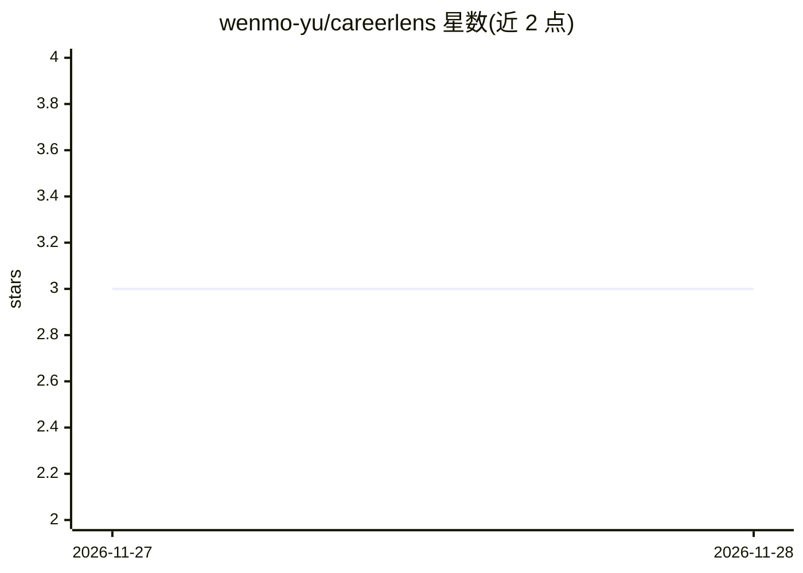

# wenmo-yu/careerlens

⭐ 3 · Python · MIT · 推送 2026-11-27 · [GitHub](https://github.com/wenmo-yu/careerlens) · [官网](https://wenmo-yu.github.io/careerlens/) · 个人维护 · 中文 README

**证据驱动的职业决策 Agent：简历/JD 匹配可回查**

CareerLens 是面向求职者的职业决策 Agent 应用：把简历、自述与平台导出整理成带 Evidence ID 的证据，构建结构化画像；输入岗位 JD 后逐条判定 strong/partial/gap，给出缺口与按每周时间排期的学习路线，并生成保留历史版本的报告。默认使用无需密钥的 Demo 模式与轻量检索，真实模型（DeepSeek/OpenAI 兼容/本地 Qwen）与 OCR/ASR 为可选接入。检索走 Qdrant Dense+Sparse+RRF，不可用时降级本地混合检索。配套从概念到源码的完整教程，后端 246 项 pytest 测试。

## 筛选速览

| 维度 | 判定 | 备注 |
|---|---|---|
| AI 角色 | `ai-native` | 本体是模型或模型工具 |
| 许可风险 | `permissive` | MIT |
| 部署形态 | `self-host` | docker 或自建部署 |
| 模型依赖 | — | README 未给出锁定关系 |
| 硬件要求 | — | 无带数字的原话,不猜 |
| 安装摩擦 | `low` | 无编译、无系统依赖或容器化 |
| 成熟度 | — | 结构信号不足 |

## 能力要点

- 画像与匹配结论保留 Evidence ID，可回看原始证据
- 逐条 JD 判定 strong/partial/gap 并按每周投入排学习路线
- Qdrant Dense+Sparse+RRF 混合检索，不可用时自动降级本地检索
- 持久化 Run + Worker 后台长任务，SSE 进度、断线续看与幂等恢复

## 适用场景

- 上传简历与目标 JD，获得逐条匹配判断与能力缺口
- 按每周可投入时间生成学习路线并回写作品证据
- 通过 Career Copilot 追问结论并展开原始证据
- 从零跟做教程学习 Agent/RAG/LangGraph 工程实现

## 场景标签

`RAG` `教程课程` · 领域:知识与检索

## 证据(README 行号)

> L13: CareerLens 是一个**证据驱动的职业决策 Agent**：把简历、自述与平台导出整理成可追溯的 **Evidence**，构建结构化画像；输入岗位 JD 后逐条比对，给出匹配判断、能力缺口、学习路线和职业报告——**每个
> L17: > 本机运行默认使用确定性 Demo 模型与轻量检索，不需要配置模型密钥；真实模型（DeepSeek / OpenAI-compatible / 本地 Qwen、OCR/ASR）为可选接入。
> L118: |模型|Demo / DeepSeek / OpenAI-compatible / 本地 Qwen|无密钥可复现，角色绑定与串级重排可配置|

## 星数曲线

2026-11-27 3 → 2026-11-28 3（+0）

---
*卡片 v1 · prompt 1.4 · 生成 2026-11-27 · 置信度 high · 依据 README sha `4e31085cc358` · [字段定义](../../DATASET.md)*
