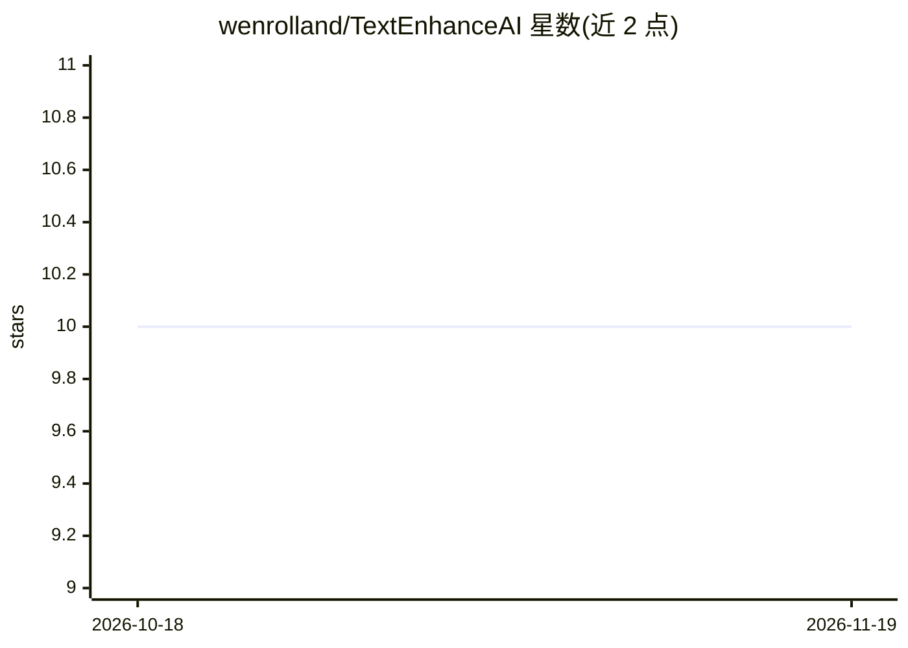

# wenrolland/TextEnhanceAI

⭐ 10 · Python · GPL-3.0 · 推送 2026-07-13 · [GitHub](https://github.com/wenrolland/TextEnhanceAI) · 个人维护

**本地 Markdown 编辑器，调用本地 LLM 校对改写文本**

基于 Python/Tkinter 的桌面 Markdown 编辑器，通过本地运行的 Ollama 对文本执行语法检查、校对、精简、改写、翻译等 11 种编辑模式，全程不发送到云端。核心机制是逐句审查工作流：每处改动分组展示，用户可逐句或逐词组接受/拒绝，全部决定后才应用到文档，并支持撤销。生成在后台运行可取消，模型连接状态可见，编辑历史写入本地 scratchpad 文件。

## 筛选速览

| 维度 | 判定 | 备注 |
|---|---|---|
| AI 角色 | `ai-native` | 本体是模型或模型工具 |
| 许可风险 | `viral` | GPL-3.0 |
| 部署形态 | `library` | 以包/库形式分发 |
| 模型依赖 | local-ok | 支持本地模型 |
| 硬件要求 | `cpu-ok` | |
| 安装摩擦 | `low` | 无编译、无系统依赖或容器化 |
| 成熟度 | — | 结构信号不足 |

## 能力要点

- 逐句/逐词组的结构化审查工作流，全部决定后才能应用
- 11 种编辑模式（Grammar、Proofread、Rewrite、Translate、Custom 等）
- 后台生成可取消，编辑器保持响应
- 支持切换本地模型（默认 llama3.1:8b，可用 TEAI_MODEL 环境变量覆盖）

## 适用场景

- 在离线/本地环境下校对和润色 Markdown 文稿
- 逐句审查 AI 改写建议后再应用到文档
- 用本地模型对文本做翻译或精简改写

## 场景标签

`AI 写作` · 领域:内容生成

## 证据(README 行号)

> L3: TextEnhanceAI is a local desktop editor that uses Ollama to proofread, rewrite, translate, and improve text without 
> L16: - **Editing modes:** Grammar, Proofread, Natural, Streamline, Awkward, Rewrite, Concise, Polish, Improve, Translate
> L23: - Ollama installed and running

## 星数曲线

2026-10-18 10 → 2026-11-19 10（+0）

---
*卡片 v1 · prompt 1.4 · 生成 2026-11-19 · 置信度 high · 依据 README sha `a26996db0b96` · [字段定义](../../DATASET.md)*
