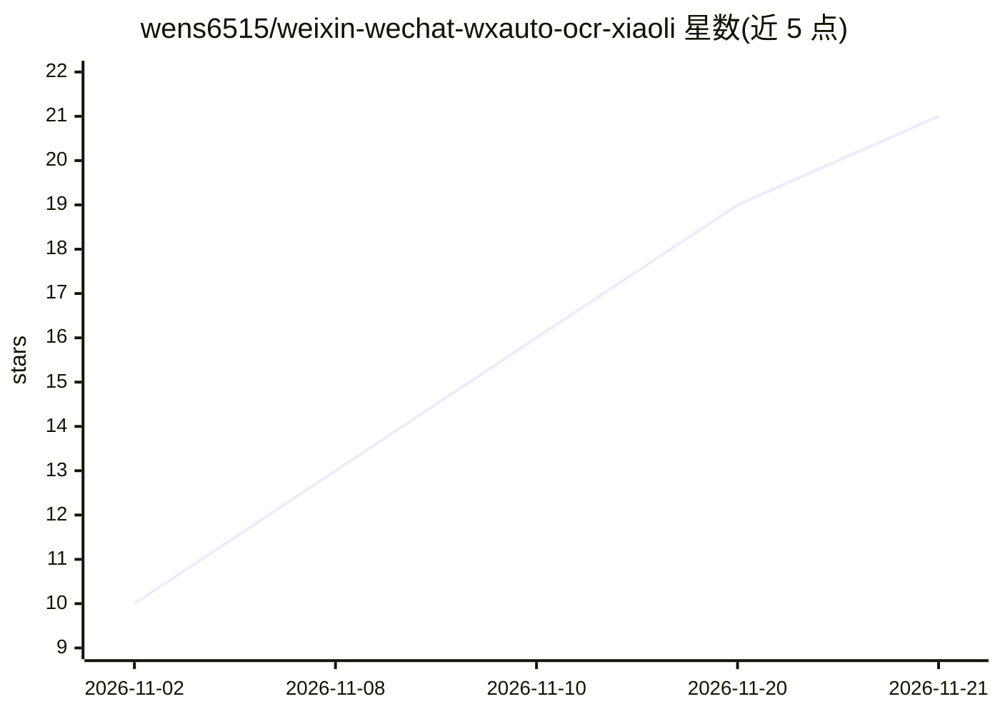

# wens6515/weixin-wechat-wxauto-ocr-xiaoli

⭐ 21 · Python · MIT · 推送 2026-11-08 · [GitHub](https://github.com/wens6515/weixin-wechat-wxauto-ocr-xiaoli) · 个人维护 · 中文 README

**微信 PC 4.x 的纯视觉 OCR 自动回复机器人，带长记忆与任务投递**

运行在 Windows 上的微信 AI 机器人桌面应用（小漓）：不依赖 UIA/CDP/本地数据库，通过 PrintWindow 截图 + RapidOCR（PP-OCRv5 mobile）识别微信界面消息，调用 OpenAI 兼容 LLM（默认 DeepSeek）自动回复私聊与群聊，支持图片/文件/引用消息识别、经自部署 TTS 服务（如 GPT-SoVITS）发送语音、三层长记忆与记忆管理页，并把复杂任务投递给天枢 CLI 代理处理后回传成果文件。提供桌面安装包与后端核心源码；限制：微信窗口大小被固定为工作区右半屏、运行期间不可最小化，部分分辨率与缩放组合可能存在未覆盖 bug。

## 筛选速览

| 维度 | 判定 | 备注 |
|---|---|---|
| AI 角色 | `ai-native` | 本体是模型或模型工具 |
| 许可风险 | `permissive` | MIT |
| 部署形态 | `desktop` | 安装包/桌面程序 |
| 模型依赖 | locked-api |  |
| 硬件要求 | — | 无带数字的原话,不猜 |
| 安装摩擦 | `low` | 无编译、无系统依赖或容器化 |
| 成熟度 | `idea` | |

## 能力要点

- 纯视觉通道：截图 + RapidOCR 识别微信消息，不碰 UIA/CDP/本地数据库
- 长记忆三层：近期窗口 + 深层存档（recall_memory 检索）+ 可选记忆压缩/全局记忆/共享记忆池
- 任务桥：任务型请求投递天枢 CLI 处理并自动回传成果文件
- 未读红圈像素检测 + 变化检测先行，0.5s 轮询约占总 CPU 1%

## 适用场景

- 让 AI 在微信私聊/群聊自动回复消息
- 识别微信里的图片、文件与引用消息并回应
- 把'根据文档做网站'类任务交给 AI 代理处理后收回成果文件
- 手机浏览器经局域网远程查看机器人状态与用量

## 场景标签

`聊天机器人` `语音合成` `OCR` `Agent 记忆` · 领域:Agent 开发

## 证据(README 行号)

> L41: 小漓是一个运行在 Windows 上的微信 AI 机器人桌面应用：自动回复微信消息（聊天/提问）、识别图片与文件、发送语音，并把复杂任务投递给 AI 代理（天枢 CLI）处理，处理完成后自动把成果文件回传微信。
> L68: - 💬 **微信自动回复**：监听微信消息，用 LLM（默认 DeepSeek）生成回复；私聊/群聊语境区分，群聊仅响应 `@小漓`；可开启**智能静默**——AI 自己决定要不要回某条消息（对方话没说完、自言自语时保持沉默等下一
> L183: - **视觉通道唯一**：微信 4.1.12+ 关闭了 UIA/CDP/窗口消息/本地数据读取等全部高效通道（验证过程见 `docs/微信通道验证结论.md`），PrintWindow 截图 + OCR 是唯一可用通道

## 星数曲线

2026-11-02 10 → 2026-11-21 21（+11）

---
*卡片 v1 · prompt 1.4 · 生成 2026-11-18 · 置信度 high · 依据 README sha `09a204ba579e` · [字段定义](../../DATASET.md)*
