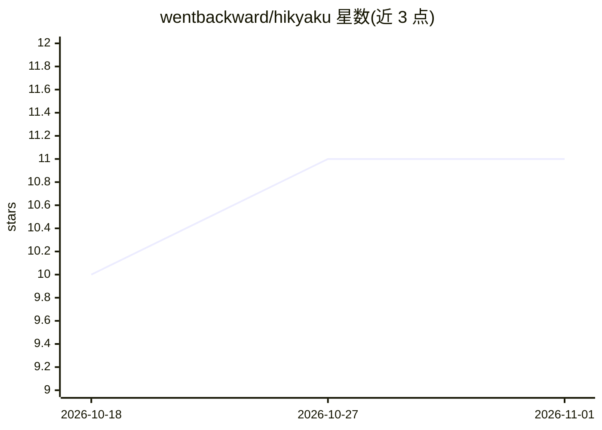

# wentbackward/hikyaku

⭐ 11 · Go · MIT · 推送 2026-09-28 · [GitHub](https://github.com/wentbackward/hikyaku) · [官网](https://hikyaku.ai/) · 个人维护

**AI 推理代理与负载均衡器：虚拟化模型、统一本地与云端后端**

用 Go 编写的 AI 推理路由代理：客户端指向单一 URL，代理将 OpenAI/Anthropic/Ollama 原生格式的请求转发到本地或云端后端，不做协议翻译。支持虚拟模型（同一模型多参数档案）、三层参数合并（defaults/caller/clamp）、四种负载均衡策略（含 KV-cache 亲和的 sticky_least_loaded）、基于真实流量的健康判定与故障迁移。内置 OpenTelemetry 指标与 Prometheus 导出，SIGHUP 热重载，单静态二进制约 7 MB Docker 镜像。面向管理多推理后端的运维与开发团队。

## 筛选速览

| 维度 | 判定 | 备注 |
|---|---|---|
| AI 角色 | `ai-ecosystem` | LLM/agent 周边工具 |
| 许可风险 | `permissive` | MIT |
| 部署形态 | `self-host` | docker 或自建部署 |
| 模型依赖 | local-ok | 支持本地模型 |
| 硬件要求 | — | 无带数字的原话,不猜 |
| 安装摩擦 | `low` | 无编译、无系统依赖或容器化 |
| 成熟度 | — | 结构信号不足 |

## 能力要点

- 虚拟模型：同名底层模型配不同参数档案，客户端切换模型名即换行为
- 四策略负载均衡与 KV-cache 亲和、ground-truth 健康判定、failover 迁移
- OpenTelemetry 指标（TTFT/token 数等）+ Prometheus 导出，SIGUSR1 全报文捕获
- 单静态 Go 二进制，~7 MB scratch Docker 镜像，SIGHUP 热重载

## 适用场景

- 把多个本地与云端推理后端聚合成一个统一端点供团队使用
- 在代理层锁定采样参数（如 max_tokens 上限、温度）
- 调试消息流并获取 OTel 指标定位推理性能问题
- 让 OpenWebUI 等客户端从下拉列表直接选用虚拟模型

## 场景标签

`模型网关` · 领域:Agent 开发

## 证据(README 行号)

> L13: An enterprise grade, highly performant route virtualizer for your infrerence workloads. Written in Golang for speed
> L31: client → hikyaku:4000/v1 → vLLM (local)
> L39: **Unify your backends.** Point your client at one URL. The proxy forwards requests transparently — model resolution

## 星数曲线

2026-10-18 10 → 2026-11-01 11（+1）

---
*卡片 v1 · prompt 1.4 · 生成 2026-11-01 · 置信度 high · 依据 README sha `c23188c82e80` · [字段定义](../../DATASET.md)*
