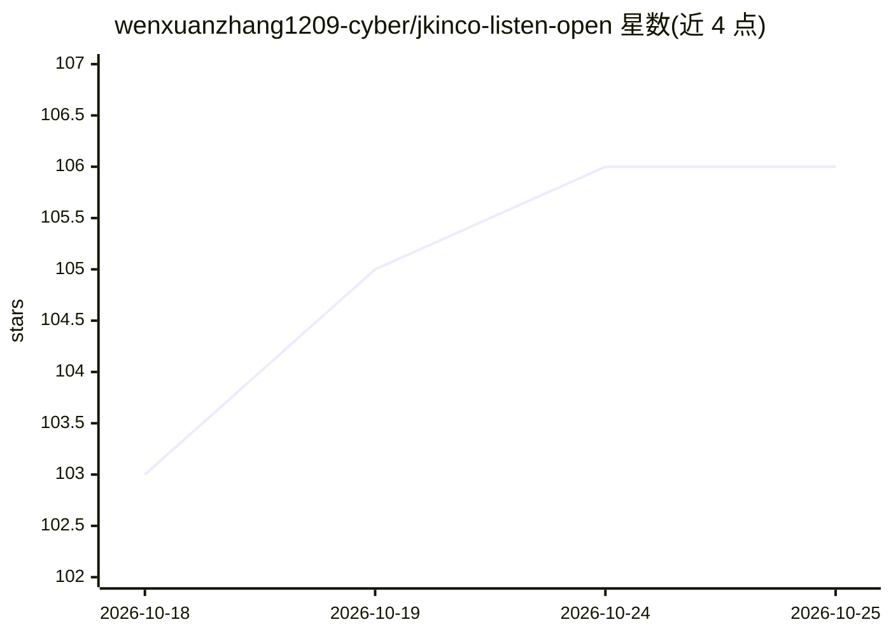

# wenxuanzhang1209-cyber/jkinco-listen-open

⭐ 106 · Python · MIT · 推送 2026-10-24 · [GitHub](https://github.com/wenxuanzhang1209-cyber/jkinco-listen-open) · [官网](https://wenxuanzhang1209-cyber.github.io/jkinco-listen-open/) · 个人维护 · 中文 README

**全本地运行的 AI 会议纪要工作台：录音转写到 DOCX/PDF 导出**

本地优先的会议纪要应用：FastAPI 后端 + React 前端，流程为录音→FunASR paraformer-zh 中文转写→场景识别→结构化纪要→DOCX/PDF 导出，全程无 API key、无云端调用。LLM 部分通过 Ollama 或任意 OpenAI 兼容端点运行本地模型（默认 qwen2.5:7b-instruct），场景识别采用规则门控优先、模型在后的机制，共五种会议类型。面向不能上传录音的受监管行业（工程例会、面试、客户拜访）。docker compose 一键部署，首次启动自动下载 ASR 模型（约 1-2 GB）；16 GB 内存推荐，CPU 可运行。限制：ASR 与领域词表面向中文会议调优；实时字幕为实验性且默认关闭。

## 筛选速览

| 维度 | 判定 | 备注 |
|---|---|---|
| AI 角色 | `ai-native` | 本体是模型或模型工具 |
| 许可风险 | `permissive` | MIT |
| 部署形态 | `self-host` | docker 或自建部署 |
| 模型依赖 | local-ok | 支持本地模型 |
| 硬件要求 | `cpu-ok` | |
| 安装摩擦 | `low` | 无编译、无系统依赖或容器化 |
| 成熟度 | `idea` | |

## 能力要点

- FunASR paraformer-zh 本地中文转写（VAD、标点恢复、领域词纠错）
- 证据门控的场景识别：五种会议类型，规则门优先于模型
- DOCX/PDF 导出保留企业原始模板版式，六种模板
- 本地知识库：跨历史会议全文检索与问答，数据存于本地 SQLite

## 适用场景

- 不能上传录音的行业在本地完成会议纪要整理
- 工程例会、面试、客户拜访等场景自动套用对应纪要模板
- 会前零配置试用：Demo 模式免模型体验导出与检索

## 场景标签

`语音识别` `AI 写作` · 领域:内容生成

## 证据(README 行号)

> L5: **A local-first AI workbench that turns meeting recordings into finished minutes.**
> L7: Recording → transcript → scene detection → structured minutes → DOCX/PDF, running **entirely on your own machine**.
> L31: - **Local speech recognition** — Chinese meeting-grade ASR with voice-activity detection,

## 星数曲线

2026-10-18 103 → 2026-10-25 106（+3）

---
*卡片 v1 · prompt 1.4 · 生成 2026-10-23 · 置信度 mid · 依据 README sha `b30e5f2ae807` · [字段定义](../../DATASET.md)*
