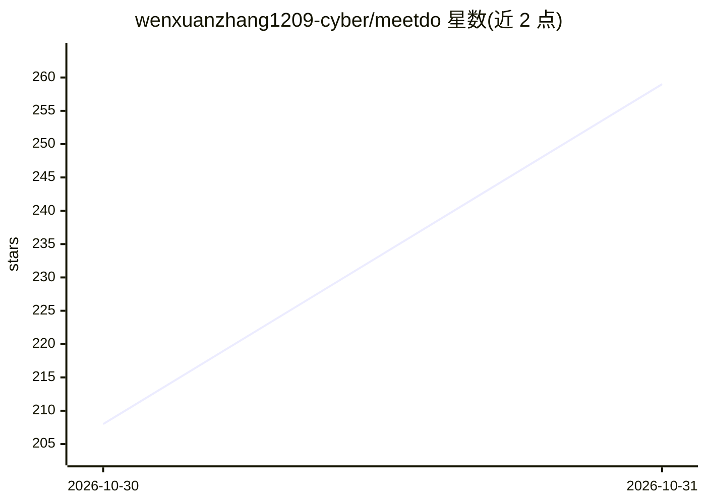

# wenxuanzhang1209-cyber/meetdo

⭐ 259 · Python · MIT · 推送 2026-10-29 · [GitHub](https://github.com/wenxuanzhang1209-cyber/meetdo) · [官网](https://jkincolisten.cloud) · 组织维护 · 中文 README

**自托管的会议转行动 AI：本地 ASR/LLM 生成结构化纪要并导出 DOCX/PDF**

筑听·JKinco Listen 的开源版：浏览器发起自托管 LiveKit 会议，字幕由本地 FunASR paraformer-zh 流式识别（含 VAD、标点恢复、领域词纠错），本地 LLM（Ollama 或任意 OpenAI 兼容端点）完成场景检测、纪要生成与会议问答，按 5 种会议类型及自定义模板导出保持原版式的 DOCX/PDF；历史存于本地 SQLite。docker compose 一条命令部署，无云端模型调用。面向需要会议数据不出本机、且要把转录变成可归档文档的团队。

## 筛选速览

| 维度 | 判定 | 备注 |
|---|---|---|
| AI 角色 | `ai-native` | 本体是模型或模型工具 |
| 许可风险 | `permissive` | MIT |
| 部署形态 | `self-host` | docker 或自建部署 |
| 模型依赖 | local-ok | 支持本地模型 |
| 硬件要求 | — | 无带数字的原话,不猜 |
| 安装摩擦 | `low` | 无编译、无系统依赖或容器化 |
| 成熟度 | — | 结构信号不足 |

## 能力要点

- 自托管 LiveKit 会议 + 本地流式 ASR 字幕
- 本地 LLM 完成场景检测、纪要生成与会议问答（Ollama / OpenAI 兼容端点）
- 证据门控的场景检测：规则先行，模型不能强加模板
- 保持企业模板原版式的 DOCX/PDF 导出，历史存本地 SQLite

## 适用场景

- 管理层会议、项目周会上实时出字幕并自动生成可归档纪要
- 音频不能离开本机的合规场景下自托管会议记录
- 跨历史会议做本地知识库检索与问答

## 场景标签

`语音识别` `AI 写作` `文档问答` · 领域:内容生成

## 证据(README 行号)

> L10: MeetDo is the open-source edition of 筑听 · JKinco Listen. Start a browser meeting with
> L11: self-hosted media, watch captions stream from a local ASR model, and finish with structured
> L116: - **Local LLM** — scene detection, minutes generation, quality review, and meeting Q&A run
> L117:  against a model you host (Ollama, or any OpenAI-compatible endpoint).

## 星数曲线

2026-10-30 208 → 2026-10-31 259（+51）

---
*卡片 v1 · prompt 1.4 · 生成 2026-10-30 · 置信度 mid · 依据 README sha `7a643c114091` · [字段定义](../../DATASET.md)*
