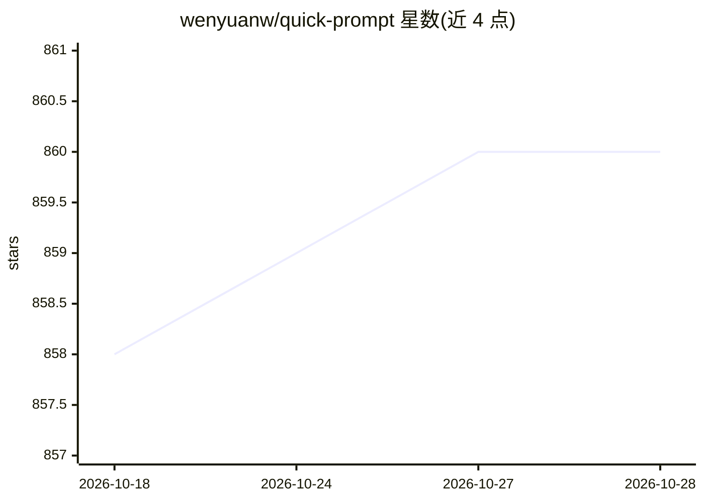

# wenyuanw/quick-prompt

⭐ 860 · TypeScript · MIT · 推送 2026-08-25 · [GitHub](https://github.com/wenyuanw/quick-prompt) · [官网](https://quick-prompt.wenyuanw.me/) · 个人维护 · 中文 README

**浏览器插件：在任何网页输入框快速插入与管理的提示词库**

基于 WXT 构建的浏览器扩展（支持 Chrome/Edge 与 Firefox），提供提示词的创建、编辑、分类、标签与变量（{{变量名}} 格式）管理；在任何网页输入框通过 /p 或快捷键调出选择器插入预设内容，支持右键/快捷键保存选中文本为提示词，支持 JSON 导入导出及 WebDAV、Notion、GitHub/Gitee Gist 云同步。插件本体不调用模型，仅管理与插入提示词文本。可通过应用商店、GitHub Releases 或源码（pnpm）安装。

## 筛选速览

| 维度 | 判定 | 备注 |
|---|---|---|
| AI 角色 | `ai-enhanced` | 去掉 AI 部分产品仍成立 |
| 许可风险 | `permissive` | MIT |
| 部署形态 | `library` | 以包/库形式分发 |
| 模型依赖 | — | README 未给出锁定关系 |
| 硬件要求 | — | 无带数字的原话,不猜 |
| 安装摩擦 | `low` | 无编译、无系统依赖或容器化 |
| 成熟度 | — | 结构信号不足 |

## 能力要点

- 任何网页输入框中 /p 或快捷键触发提示词选择器插入内容
- 提示词支持分类、标签、附件与 {{变量名}} 变量填值
- WebDAV / Notion / GitHub-Gitee Gist 云端同步与 JSON 导入导出
- 右键菜单或快捷键将选中网页文本保存为提示词

## 适用场景

- 把常用 AI 提示词存在浏览器里，随时在任何输入框快速插入
- 跨设备同步和维护提示词库
- 选中网页文本一键收藏为提示词

## 场景标签

`提示工程` · 领域:Agent 开发

## 证据(README 行号)

> L28: 一个强大的浏览器扩展，专注于提示词管理与快速输入。帮助用户创建、管理和组织提示词库，并在任何网页输入框中快速插入预设的 Prompt 内容，提高工作效率。
> L33: - 🚀 **快速输入**：在任何网页输入框中通过 `/p` 快速触发提示词选择器
> L37: - 🧑‍💻 **变量支持**：提示词中可以使用 `{{变量名}}` 格式的变量，使用时可以填写具体的值

## 星数曲线

2026-10-18 858 → 2026-10-28 860（+2）

---
*卡片 v1 · prompt 1.4 · 生成 2026-10-21 · 置信度 low · 依据 README sha `9999a9e29f29` · [字段定义](../../DATASET.md)*
