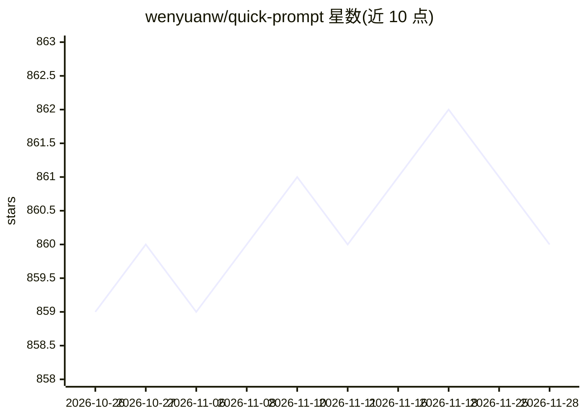

# wenyuanw/quick-prompt

⭐ 860 · TypeScript · MIT · 推送 2026-11-20 · [GitHub](https://github.com/wenyuanw/quick-prompt) · [官网](https://quick-prompt.wenyuanw.me/) · 个人维护 · 中文 README

**管理提示词库并在任意网页输入框快速插入的浏览器插件**

面向日常使用 AI 对话工具的用户的浏览器扩展：集中创建、编辑、分类提示词，通过 /p 指令或快捷键在任意输入框调出选择器插入预设内容，支持 {{变量名}} 占位符、右键保存选中文本、搜索过滤。数据层提供 JSON 导出导入备份，以及 WebDAV、Notion 数据库、Gitee/GitHub Gist 三种云端同步途径。支持 Chrome/Firefox 商店安装、Releases 下载或源码构建。插件本身不调用模型，定位是提示词的输入效率工具。

## 筛选速览

| 维度 | 判定 | 备注 |
|---|---|---|
| AI 角色 | `ai-enhanced` | 去掉 AI 部分产品仍成立 |
| 许可风险 | `permissive` | MIT |
| 部署形态 | `library` | 以包/库形式分发 |
| 模型依赖 | — | README 未给出锁定关系 |
| 硬件要求 | — | 无带数字的原话,不猜 |
| 安装摩擦 | `low` | 无编译、无系统依赖或容器化 |
| 成熟度 | — | 结构信号不足 |

## 能力要点

- /p 快捷指令与快捷键在任意网页输入框调出提示词选择器
- 提示词支持 {{变量名}} 变量、分类、标签与附件
- WebDAV / Notion / Gitee·GitHub Gist 云端同步与 JSON 导出导入
- 选中文本可经快捷键或右键菜单保存为提示词

## 适用场景

- 在多个 AI 聊天网站间复用统一维护的提示词库
- 把常用指令做成带变量的模板，插入时填参数
- 团队或个人跨设备同步提示词收藏

## 场景标签

`提示工程` · 领域:Agent 开发

## 证据(README 行号)

> L28: 一个强大的浏览器扩展，专注于提示词管理与快速输入。帮助用户创建、管理和组织提示词库，并在任何网页输入框中快速插入预设的 Prompt 内容，提高工作效率。
> L33: - 🚀 **快速输入**：在任何网页输入框中通过 `/p` 快速触发提示词选择器
> L39: - 🔗 **云端同步**：提示词库支持 WebDAV 同步、Notion 数据库、 Gitee/GitHub Gist 同步

## 星数曲线

2026-10-26 859 → 2026-11-28 860（+1）

---
*卡片 v1 · prompt 1.4 · 生成 2026-11-24 · 置信度 mid · 依据 README sha `2d9813b33e91` · [字段定义](../../DATASET.md)*
