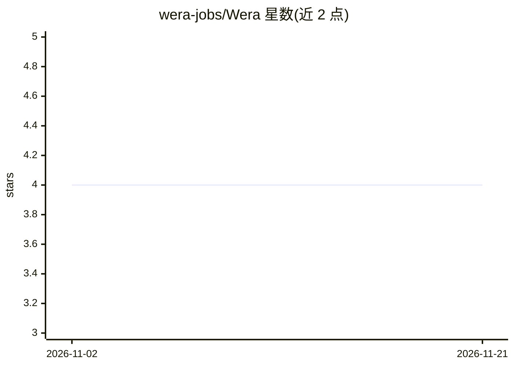

# wera-jobs/Wera

⭐ 4 · Go · MIT · 推送 2026-11-19 · [GitHub](https://github.com/wera-jobs/Wera) · [官网](https://wera-jobs.com) · 组织维护

**求职者的职位雷达：抓取职位并按简历做 LLM 匹配评分**

wera-jobs.com 的后端服务（Go 编写）：抓取 Greenhouse、Lever、Ashby 等 10 类招聘板、5,100+ 公司的公开职位，经规则过滤、TF-IDF 本地排序、共享 LLM 事实抽取、本地嵌入排序，最后按每日限额（默认 100）对最匹配职位做 LLM fit 评分。提供 REST API，简历渲染（Typst 四模板）、AI 求职信、AI 审核社区帖、面试题库与 H-1B LCA 数据查询。不支持代为投递，用户自行确认后申请。

## 筛选速览

| 维度 | 判定 | 备注 |
|---|---|---|
| AI 角色 | `ai-native` | 本体是模型或模型工具 |
| 许可风险 | `permissive` | MIT |
| 部署形态 | `self-host` | docker 或自建部署 |
| 模型依赖 | — | README 未给出锁定关系 |
| 硬件要求 | — | 无带数字的原话,不猜 |
| 安装摩擦 | `low` | 无编译、无系统依赖或容器化 |
| 成熟度 | — | 结构信号不足 |

## 能力要点

- 漏斗式匹配：规则过滤→本地排序→LLM 事实抽取→AI 评分，单次评分约 $0.00018
- 每日评分限额与 12 连续失败熔断，控制 LLM 成本与供应商中断影响
- 简历四模板渲染（Typst 约 50ms）并支持 LaTeX 导出与逐条 AI 改写
- 内置美国劳工部 H-1B LCA 数据导入与雇主签证担保查询

## 适用场景

- 按个人简历从 50 万+ 在招职位中筛出高匹配岗位
- 为不同职位生成定制简历与求职信
- 查询雇主 H-1B 担保记录辅助决策
- 自托管部署一套职位追踪与评分服务

## 场景标签

`网页抓取` `AI 写作` · 领域:效率与自动化

## 证据(README 行号)

> L10: **Wera** (Swahili slang for a job or gig) is a job search service at wera-jobs.com, and this repository is its back
> L34: 7. **Rank without AI**: each posting's facts and each profile are embedded once by a local model (the `wera-embed` 

## 星数曲线

2026-11-02 4 → 2026-11-21 4（+0）

---
*卡片 v1 · prompt 1.4 · 生成 2026-11-21 · 置信度 high · 依据 README sha `4d813a5d3754` · [字段定义](../../DATASET.md)*
