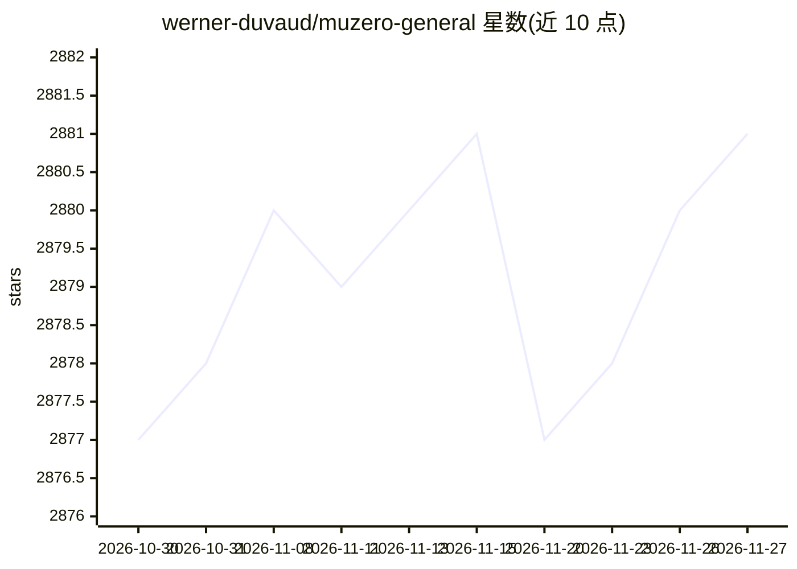

# werner-duvaud/muzero-general

⭐ 2,881 · Python · MIT · 推送 2026-11-16 · [GitHub](https://github.com/werner-duvaud/muzero-general) · [官网](https://github.com/werner-duvaud/muzero-general/wiki/MuZero-Documentation) · 个人维护

**给研究者的 MuZero 教学级 PyTorch 实现，可接入 Gymnasium 环境训练**

基于 DeepMind 2019 论文与原始伪代码的 MuZero 实现，标注教育目的，用 PyTorch 与 Ray 构建。网络将观测编码为潜在状态，预测动作对状态的影响及回报、价值与策略，配合 MCTS 选择动作。支持全连接/残差网络、并行自对弈、优先回放、reanalysis，覆盖单人与双人回合制离散动作游戏；通过新增游戏文件（config + Game 适配器）接入自定义环境。附带 CartPole、LunarLander、Breakout、井字棋、OpenSpiel、MiniGrid 等训练示例与检查点，提供训练、评估、TensorBoard 监控、渲染与超参数搜索入口。图像环境的 replay 快照可达数 GB。

## 筛选速览

| 维度 | 判定 | 备注 |
|---|---|---|
| AI 角色 | `ai-native` | 本体是模型或模型工具 |
| 许可风险 | `permissive` | MIT |
| 部署形态 | `library` | 以包/库形式分发 |
| 模型依赖 | — | README 未给出锁定关系 |
| 硬件要求 | — | 无带数字的原话,不猜 |
| 安装摩擦 | `medium` | 含编译或系统依赖之一 |
| 成熟度 | — | 结构信号不足 |

## 能力要点

- 基于 2019 论文与原始伪代码的教学级实现，附注释与代码指南
- 支持全连接/残差网络、并行自对弈、优先回放与 reanalysis
- 井字棋检查点经 200 局 MCTS 评估获得非败认证
- 通过 games/my_game.py 适配器接入自定义 Gymnasium 环境

## 适用场景

- 学习 MuZero/AlphaZero 算法原理并跑通训练实验
- 在自己的 Gymnasium 环境上做 model-based 强化学习研究
- 用提供的检查点直接做评估或复现学习曲线

## 场景标签

`强化学习` · 领域:训练与推理

## 证据(README 行号)

> L6: An educational and commented implementation of MuZero, based on DeepMind's 2019 paper and original pseudocode, built
> L12: The implementation supports fully connected and residual networks, parallel self-play, prioritized replay, reanalys
> L14: To adapt it to a new environment, add a game file containing its configuration and `Game` adapter. See CartPole for

## 星数曲线

2026-10-30 2,877 → 2026-11-27 2,881（+4）

---
*卡片 v1 · prompt 1.4 · 生成 2026-11-23 · 置信度 high · 依据 README sha `ea780016f6d0` · [字段定义](../../DATASET.md)*
