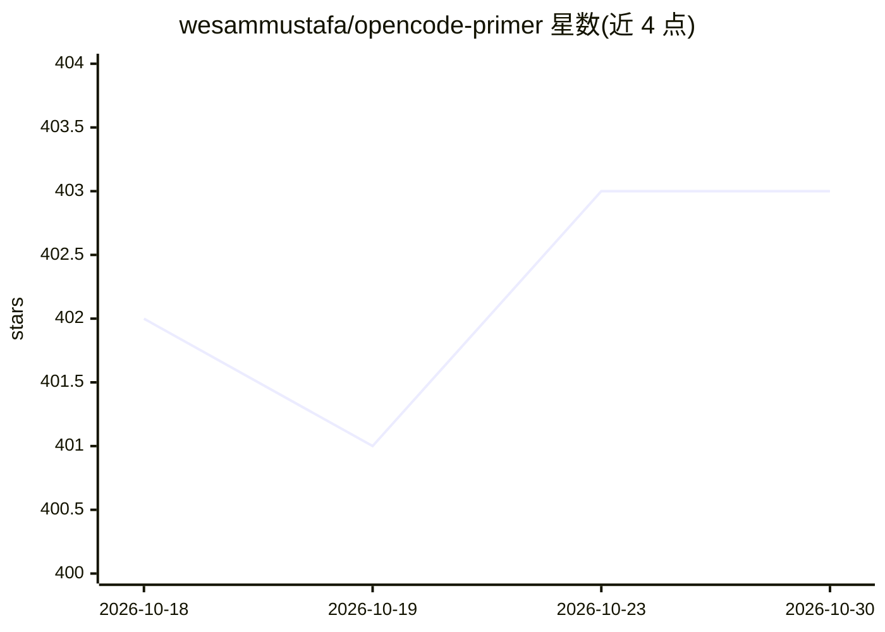

# wesammustafa/opencode-primer

⭐ 403 · JavaScript · MIT · 推送 2026-07-05 · [GitHub](https://github.com/wesammustafa/opencode-primer) · 个人维护

**社区维护的 OpenCode（开源 AI 编程 agent）使用指南**

面向正在使用或准备使用 OpenCode 的开发者编写的教程仓库，覆盖安装认证、Plan/Build 双 agent 工作流、自定义命令、技能、插件、MCP 集成、模型与供应商接入（直连 API / Zen 网关 / Go 订阅 / 本地模型）及 headless CI 用法。声明非官方、社区维护，所有内容对照 OpenCode v1.17.13 版本核验。仓库自身的 .opencode/ 目录提供可运行的配置示例。指南性质仓库，无独立安装产物。

## 筛选速览

| 维度 | 判定 | 备注 |
|---|---|---|
| AI 角色 | `ai-knowledge` | 知识聚合/清单类 |
| 许可风险 | `permissive` | MIT |
| 部署形态 | `library` | 以包/库形式分发 |
| 模型依赖 | — | README 未给出锁定关系 |
| 硬件要求 | — | 无带数字的原话,不猜 |
| 安装摩擦 | `low` | 无编译、无系统依赖或容器化 |
| 成熟度 | — | 结构信号不足 |

## 能力要点

- 按新手/进阶/运维三类路径组织的学习路线
- 覆盖供应商接入的四种方式（直连/Zen/Go/本地模型）及定价表
- 明确列出 OpenCode 的 8 项局限与不适配场景
- 仓库自带 .opencode/ 目录作为可参考的真实配置示例

## 适用场景

- 初次上手 OpenCode 时按路径学习安装与提示词技巧
- 配置自定义 agent、插件、MCP 与 headless CI
- 比较 Zen/Go/直连 API 等模型接入方式的成本与取舍

## 场景标签

`教程课程` · 领域:学习与行业

## 证据(README 行号)

> L5: Everything you need to know about OpenCode — from your first prompt to custom agents, skills, plugins, and MCP integ
> L17: **Who this is for:** Developers using (or about to use) OpenCode. Beginners get a guided path; power users get dept
> L19: > ⚖️ **Not affiliated with the OpenCode team.** This is a community-maintained guide. For canonical sources, check 

## 星数曲线

2026-10-18 402 → 2026-10-30 403（+1）

---
*卡片 v1 · prompt 1.4 · 生成 2026-10-22 · 置信度 mid · 依据 README sha `02dbe9e9f0b9` · [字段定义](../../DATASET.md)*
