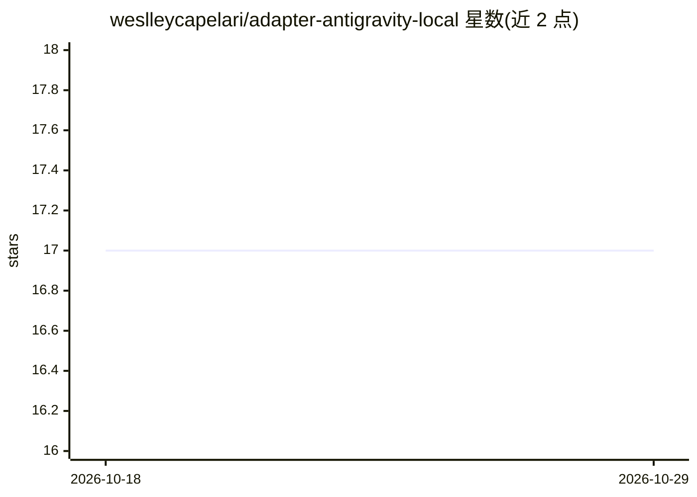

# weslleycapelari/adapter-antigravity-local

⭐ 17 · TypeScript · MIT · 推送 2026-10-20 · [GitHub](https://github.com/weslleycapelari/adapter-antigravity-local) · 个人维护

**让 Paperclip AI 调用本地 Google Antigravity (agy) CLI 的适配器**

TypeScript 编写的 Paperclip AI 适配器，用于接入本地运行的 Google Antigravity（agy CLI）agent。核心机制：解析 stream-json 事件流（含 thinking 增量、工具调用、子 agent 生命周期）、多账号配额池轮换与 429 自动切换、reasoning effort 级别映射、Paperclip skills 目录挂载（Windows junction/Unix symlink）、token 用量与成本检查点上报。通过 npm 安装到 Paperclip 扩展目录，配置项包括 command、model、effort、accountProfile 等，附 97 项测试。

## 筛选速览

| 维度 | 判定 | 备注 |
|---|---|---|
| AI 角色 | `ai-ecosystem` | LLM/agent 周边工具 |
| 许可风险 | `permissive` | MIT |
| 部署形态 | `library` | 以包/库形式分发 |
| 模型依赖 | — | README 未给出锁定关系 |
| 硬件要求 | — | 无带数字的原话,不猜 |
| 安装摩擦 | `low` | 无编译、无系统依赖或容器化 |
| 成熟度 | — | 结构信号不足 |

## 能力要点

- stream-json 事件流解析（tool_call/subagent/thinking 等）
- 多账号配额池轮换、5 小时/7 天滚动窗口记账与 429 自动切换
- reasoning effort 级别（low~max）映射到 Antigravity thinking 模型
- Windows 无管理员权限 junction 挂载 skills 目录

## 适用场景

- 在 Paperclip AI 中以本地 agy agent 作为执行后端
- 多账号轮换规避配额与速率限制
- 追踪 agent 的工具调用、MCP 与子 agent 执行轨迹

## 场景标签

`模型网关` · 领域:Agent 开发

## 证据(README 行号)

> L8: An enterprise-grade, high-performance **Paperclip AI** adapter engineered for modern **Google Antigravity** (`agy` C
> L10: This adapter serves as a robust, fully typed, production-ready integration supporting the modern Antigravity CLI ar

## 星数曲线

2026-10-18 17 → 2026-10-29 17（+0）

---
*卡片 v1 · prompt 1.4 · 生成 2026-10-29 · 置信度 high · 依据 README sha `7fc1e9400a3f` · [字段定义](../../DATASET.md)*
