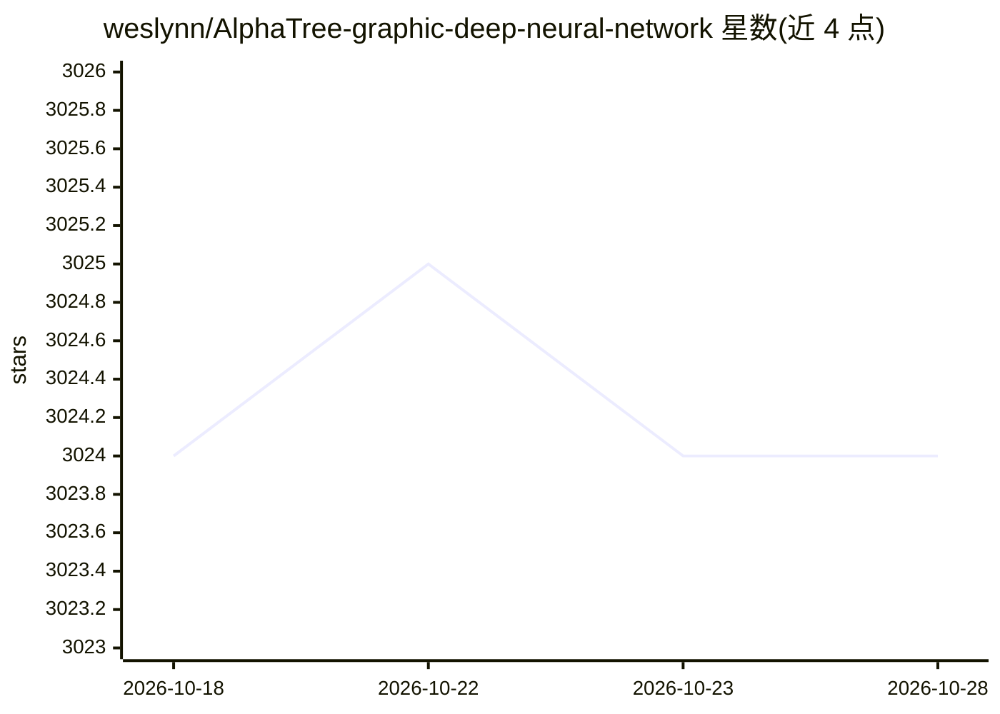

# weslynn/AlphaTree-graphic-deep-neural-network

⭐ 3,024 · 推送 2026-10-13 · [GitHub](https://github.com/weslynn/AlphaTree-graphic-deep-neural-network) · 个人维护 · 中文 README

**深度学习发展路线图与图解知识库，附交互时间线站点**

以统一风格图解深度学习经典网络结构（LeNet 到 SENet、GAN 系列等）并梳理论文发展 roadmap，2026 年由 AI 辅助重做为可交互时间线站点 alphatree.cn：148 个里程碑、可交互网络结构与算法动画、论文地铁图，内容含 2019 版静态图解源码（本地 git clone 查看 HTML/图片）。内容遵循 CC BY-NC-SA 4.0，商用需联系作者；仓库含分类网络对比表、GAN 分级教程与语音克隆等专题索引，NLP/大数据部分标注 coming soon。

## 筛选速览

| 维度 | 判定 | 备注 |
|---|---|---|
| AI 角色 | `ai-knowledge` | 知识聚合/清单类 |
| 许可风险 | `none` | — |
| 部署形态 | `None` |  |
| 模型依赖 | — | README 未给出锁定关系 |
| 硬件要求 | — | 无带数字的原话,不猜 |
| 安装摩擦 | `low` | 无编译、无系统依赖或容器化 |
| 成熟度 | — | 结构信号不足 |

## 能力要点

- 统一风格重绘经典深度学习网络结构图并配论文索引
- alphatree.cn 交互时间线站点：148 个里程碑、论文地铁图、可交互算法动画
- 覆盖分类网络对比、GAN 四级教程、语音克隆模型索引等专题
- 内容由 AI 辅助生成并人工逐条核对年份与人名

## 适用场景

- 按时间线了解从数学到深度学习的技术演进与经典论文
- 面试前系统梳理分类网络、GAN 等模型发展脉络与对比
- 查找各方向经典论文及其官方源码（tensorflow/caffe/pytorch）链接

## 场景标签

`教程课程` · 领域:学习与行业

## 证据(README 行号)

> L19: AlphaTree 最初是一个把深度学习经典网络结构「统一画一遍」的开源项目——因为论文里的同一张图，画法五花八门，看着头疼。后来拓展成了论文发展roadmap， 它曾在 2019 年意外登上 GitHub Trending，攒下
> L21: 2026 年，the dream come true，我们用 AI 工具把它整个重做了一遍：从「一堆静态图」变成了 可以交互的网络结构，那一堆文字变成了「一根能走的时间线」——覆盖从数学起源、计算机诞生、到今天大模型的三千年演进。
> L27: 但是AI中每一个领域都在日新月异的成长。而每一位研究人员写paper的风格都不一样，相似的模型，为了突出不同的改进点，他们对模型的描述和图示都可能大不相同。为了帮助更多的人在不同领域能够快速跟进前沿技术，我们构建了“AlphaTr

## 星数曲线

2026-10-18 3,024 → 2026-10-28 3,024（+0）

---
*卡片 v1 · prompt 1.4 · 生成 2026-10-20 · 置信度 high · 依据 README sha `2ad9d2a49d70` · [字段定义](../../DATASET.md)*
