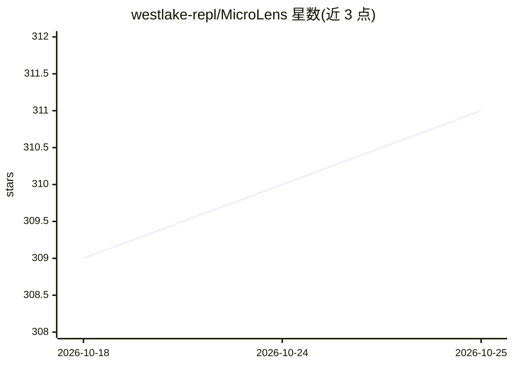

# westlake-repl/MicroLens

⭐ 312 · Python · 推送 2026-03-19 · [GitHub](https://github.com/westlake-repl/MicroLens) · 组织维护 · 中文 README

**大规模短视频多模态推荐数据集，含原始文本/图像/音频/视频**

由西湖大学实验室发布的内容驱动短视频推荐数据集 MicroLens，含用户-视频交互及原始文本、图像、音频、视频与评论等多模态数据；提供 50K/100K/1M 规模子集及提取好的多模态特征，配套 VideoRec（实现 15 个视频模型）、IDRec、VIDRec 基线代码与训练/测试脚本，运行环境要求 Python3.8、PyTorch1.8、CUDA 11.1。数据集禁止私自修改后二次分发，完整版需联系作者获取。

## 筛选速览

| 维度 | 判定 | 备注 |
|---|---|---|
| AI 角色 | `ai-knowledge` | 知识聚合/清单类 |
| 许可风险 | `none` | — |
| 部署形态 | `None` |  |
| 模型依赖 | — | README 未给出锁定关系 |
| 硬件要求 | — | 无带数字的原话,不猜 |
| 安装摩擦 | `low` | 无编译、无系统依赖或容器化 |
| 成熟度 | — | 结构信号不足 |

## 能力要点

- 提供 50K/100K/1M 规模子集与提取好的文本/图像/视频特征
- 配套 VideoRec/IDRec/VIDRec 基线代码，VideoRec 实现 15 个视频模型
- 提供 LMDB 生成脚本与视频批量下载命令示例
- 已被 MMRec 框架收录，支持 WWW 2025 MIRC 竞赛

## 适用场景

- 做多模态/内容驱动的短视频推荐研究
- 训练与评测视频理解类推荐基线模型
- 构建基础推荐模型的大规模数据来源

## 场景标签

`推荐系统` · 领域:学习与行业

## 证据(README 行号)

> L1: # MicroLens: A Content-Driven Micro-Video Recommendation Dataset at Scale
> L41: - 💡**2023/09/28**: We have temporarily released MicroLens-50K (50,000 users) and MicroLens-100K (100,000 users) alo
> L59: We have released the codes for all algorithms, including VideoRec (which implements all 15 video models in this pro

## 星数曲线

2026-10-18 309 → 2026-10-25 311（+2）

---
*卡片 v1 · prompt 1.4 · 生成 2026-10-23 · 置信度 high · 依据 README sha `f98809823a19` · [字段定义](../../DATASET.md)*
