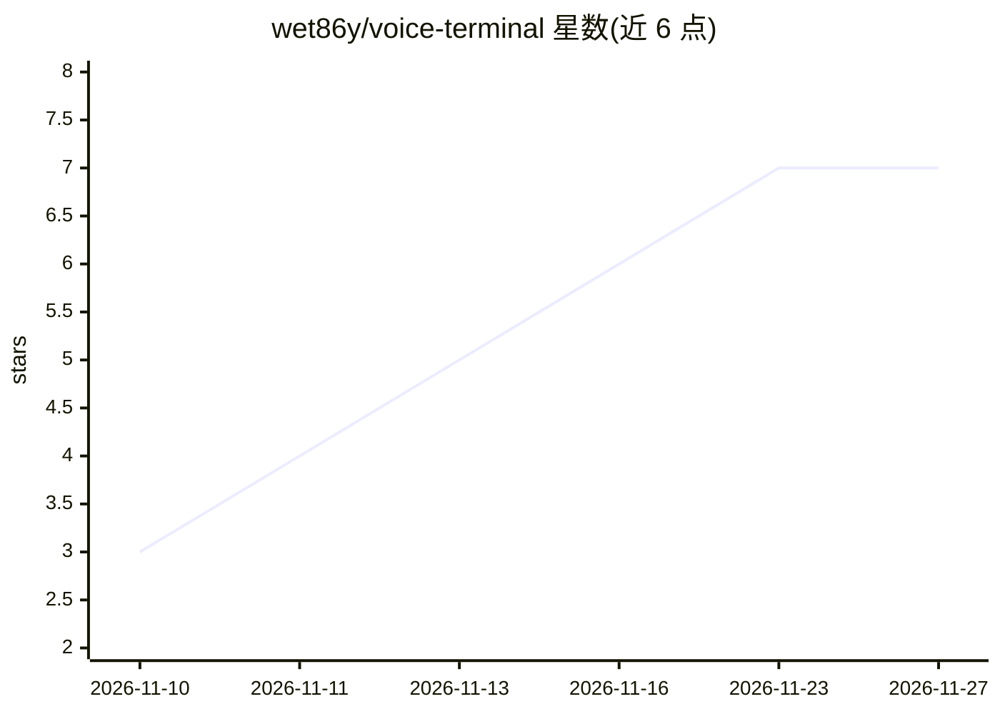

# wet86y/voice-terminal

⭐ 7 · Python · Apache-2.0 · 推送 2026-11-23 · [GitHub](https://github.com/wet86y/voice-terminal) · [官网](https://github.com/wet86y/voice-terminal/releases/latest) · 个人维护 · 中文 README

**Windows 上的个人语音 Agent，提供低延迟语音交互**

运行在 Windows 桌面的语音 Agent：流式 ASR 驱动 LLM 并维护可修订的 TTS 播放队列，支持打断、声纹识别拦截、定时任务、屏幕捕获、情绪识别与热词替换。架构上把主语音模型与后台 DeepSeek Harness 执行模型拆分，主链路用低思考挡位保延迟，后台负责任务执行。需 DeepSeek API 密钥，在线 TTS 需 MiniMax 密钥，本地 TTS 仅支持 NVIDIA 显卡；仅提供 Windows 安装器，程序仍处早期开发阶段。

## 筛选速览

| 维度 | 判定 | 备注 |
|---|---|---|
| AI 角色 | `ai-native` | 本体是模型或模型工具 |
| 许可风险 | `permissive` | Apache-2.0 |
| 部署形态 | `desktop` | 安装包/桌面程序 |
| 模型依赖 | locked-api |  |
| 硬件要求 | — | 无带数字的原话,不猜 |
| 安装摩擦 | `low` | 无编译、无系统依赖或容器化 |
| 成熟度 | `idea` | |

## 能力要点

- 流式 ASR 驱动 LLM 的可打断语音对话，fast 挡位首音延迟中位数 1266 ms
- 影子代理：主语音模型与后台高思考执行模型（DSH）分离
- 声纹识别登记与临时声纹机制拦截非主人语音
- 纯 GUI 组件管理页完成下载、更新、导入、重置

## 适用场景

- 在 Windows 桌面上通过语音与 AI agent 对话并驱动任务执行
- 用声纹识别限制只有本人能唤醒和使用语音助手
- 语音设定定时任务并通过语音链路接收提醒
- 让 agent 截屏查看屏幕内容辅助交互

## 场景标签

`语音 Agent` · 领域:对话与助手

## 证据(README 行号)

> L5:  低延迟、低成本、易配置的个人语音 Agent
> L27: 流式 ASR 识别驱动 LLM，模型维护一条**可修订的 TTS 播放队列**：后一段语音在播之前就已经开始准备，播到中途支持修订。
> L43: 后台 DSH（DeepSeek Harness）是项目主语音的执行机构。**主语音模型和后台执行模型分开设定**——主语音用低思考挡位保证延迟，后台用高思考强度保证任务执行准确性。

## 星数曲线

2026-11-10 3 → 2026-11-27 7（+4）

---
*卡片 v1 · prompt 1.4 · 生成 2026-11-20 · 置信度 high · 依据 README sha `3ad6087002f7` · [字段定义](../../DATASET.md)*
