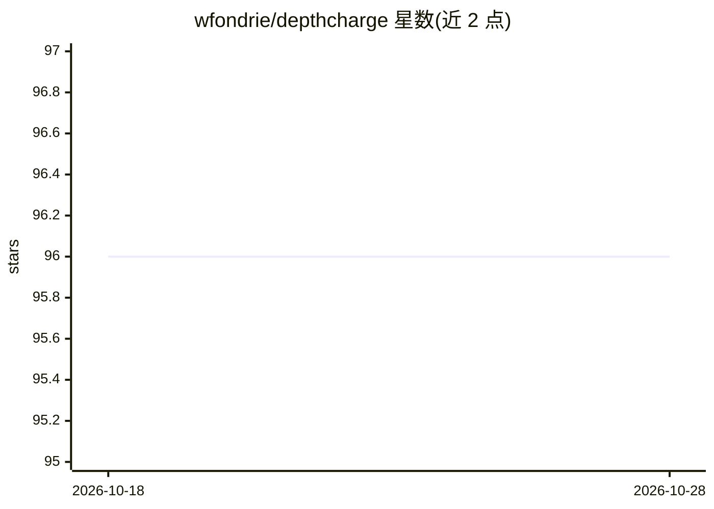

# wfondrie/depthcharge

⭐ 96 · Python · Apache-2.0 · 推送 2026-10-09 · [GitHub](https://github.com/wfondrie/depthcharge) · [官网](https://wfondrie.github.io/depthcharge/) · 个人维护

**质谱数据深度学习工具包：PyTorch 组件快速搭建 Transformer 模型**

面向质谱（及肽段、小分子等分析物）数据的深度学习工具包：以 PyTorch 模块形式提供可组装的构建块（如质谱解析为数据集、Transformer 编码器），供研究者快速搭建面向质谱任务的自定义模型。要求 Python 3.10-3.13，从 PyPI 以 pip install depthcharge-ms 安装。定位为灵活且有固定主张的框架，目的是避免各工具重复造轮子，配套文档供进一步学习。

## 筛选速览

| 维度 | 判定 | 备注 |
|---|---|---|
| AI 角色 | `ai-ecosystem` | LLM/agent 周边工具 |
| 许可风险 | `permissive` | Apache-2.0 |
| 部署形态 | `library` | 以包/库形式分发 |
| 模型依赖 | — | README 未给出锁定关系 |
| 硬件要求 | — | 无带数字的原话,不猜 |
| 安装摩擦 | `low` | 无编译、无系统依赖或容器化 |
| 成熟度 | — | 结构信号不足 |

## 能力要点

- 以 PyTorch 模块形式提供质谱深度学习构建块
- 将质谱解析为 PyTorch 数据集并用 Transformer 编码
- 面向肽段与小分子等质谱分析物的建模任务

## 适用场景

- 为质谱数据快速原型化自定义深度学习模型
- 蛋白质组学/代谢组学研究中构建 Transformer 模型
- 在现有 PyTorch 流程中加载和编码质谱数据

## 场景标签

`科研工具` · 领域:学习与行业

## 证据(README 行号)

> L3: Depthcharge is a deep learning toolkit for building Transformer models to analyze mass spectrometry data.
> L10: Depthcharge aims to provide a flexible, but opinionated, framework for rapidly prototyping deep learning models for

## 星数曲线

2026-10-18 96 → 2026-10-28 96（+0）

---
*卡片 v1 · prompt 1.4 · 生成 2026-10-23 · 置信度 high · 依据 README sha `84597bbeafa7` · [字段定义](../../DATASET.md)*
