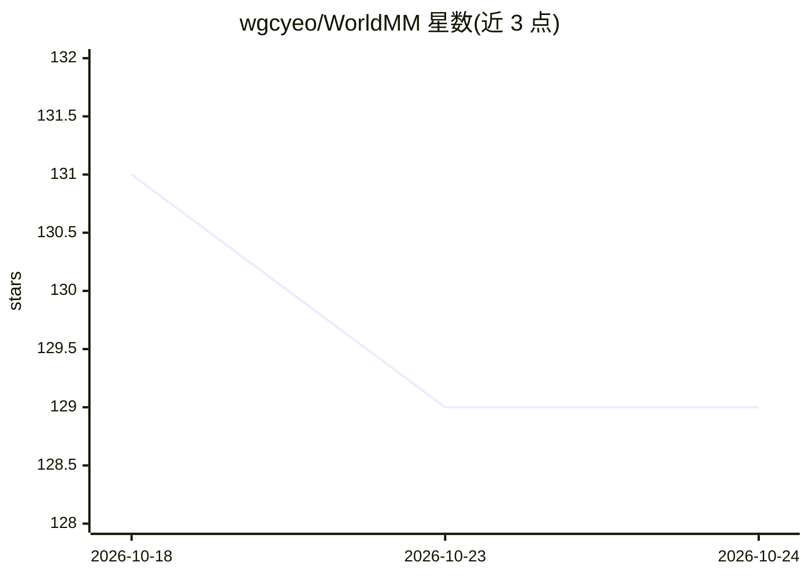

# wgcyeo/WorldMM

⭐ 129 · Python · Apache-2.0 · 推送 2026-07-29 · [GitHub](https://github.com/wgcyeo/WorldMM) · [官网](https://worldmm.github.io) · 组织维护

**长视频推理的动态多模态记忆 agent 研究框架**

CVPR 2026 论文配套代码：构建情景、语义、视觉三类多尺度多模态记忆，通过自适应检索与迭代推理回答长视频问题。默认在 EgoLife 周长视频数据集上评估（EgoLifeQA），另提供 Video-MME 基准示例流程；检索与回答使用 GPT-5 系列或 qwen3vl-8b 作为骨干模型，记忆构建默认用 gpt-5-mini。以 uv + bash 脚本形式安装运行，提供预构建记忆元数据下载以跳过构建步骤。

## 筛选速览

| 维度 | 判定 | 备注 |
|---|---|---|
| AI 角色 | `ai-native` | 本体是模型或模型工具 |
| 许可风险 | `permissive` | Apache-2.0 |
| 部署形态 | `None` |  |
| 模型依赖 | — | README 未给出锁定关系 |
| 硬件要求 | — | 无带数字的原话,不猜 |
| 安装摩擦 | `low` | 无编译、无系统依赖或容器化 |
| 成熟度 | — | 结构信号不足 |

## 能力要点

- 三类记忆模块（episodic/semantic/visual）构建与多轮自适应检索
- 支持 EgoLifeQA 与 Video-MME 等视频基准评估流程
- 骨干模型可换（gpt-5 / gpt-5-mini / qwen3vl-8b）
- 提供预构建 EgoLife 记忆元数据，可跳过构建步骤

## 适用场景

- 在周长视频数据集 EgoLife 上做长视频问答评估
- 复现论文的多模态记忆构建与检索推理流程
- 将多模态记忆 agent 流程迁移到其他视频基准

## 场景标签

`Agent 记忆` `多模态` `模型评测` · 领域:Agent 开发

## 证据(README 行号)

> L7: **WorldMM** is a novel dynamic multimodal memory agent designed for long video reasoning. It constructs multimodal, 
> L53: WorldMM builds three memory modules—episodic, semantic, and visual—to support long-term reasoning, which can be con

## 星数曲线

2026-10-18 131 → 2026-10-24 129（-2）

---
*卡片 v1 · prompt 1.4 · 生成 2026-10-23 · 置信度 high · 依据 README sha `6adcccb545f2` · [字段定义](../../DATASET.md)*
