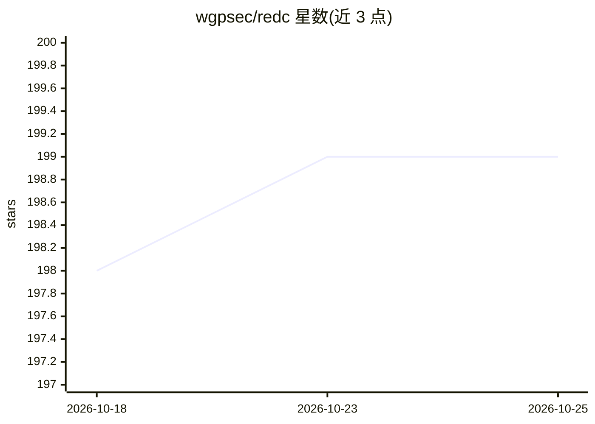

# wgpsec/redc

⭐ 199 · Go · Apache-2.0 · 推送 2026-10-10 · [GitHub](https://github.com/wgpsec/redc) · [官网](https://redc.wgpsec.org) · 组织维护 · 中文 README

**红队多云基础设施自动化部署工具，带 GUI 与 AI 助手**

基于 Terraform 构建的多云红队基础设施生命周期管理工具（创建、配置、销毁），支持阿里云、腾讯云、AWS、火山引擎等凭据接入，命令风格类 Docker（run/stop/exec/cp），可一键拉起预置攻击场景并管理资源状态。提供 Wails+Svelte 构建的 GUI，含仪表盘、7 种模式的多轮 AI 对话助手（Agent/部署助手/模板生成等）、SSH 多会话终端、80+ 工具的软件商店、定时任务与 HTTP API 服务，并支持 MCP 协议接入 AI 助手。以二进制、HomeBrew 与源码构建方式安装。

## 筛选速览

| 维度 | 判定 | 备注 |
|---|---|---|
| AI 角色 | `ai-enhanced` | 去掉 AI 部分产品仍成立 |
| 许可风险 | `permissive` | Apache-2.0 |
| 部署形态 | `library` | 以包/库形式分发 |
| 模型依赖 | — | README 未给出锁定关系 |
| 硬件要求 | — | 无带数字的原话,不猜 |
| 安装摩擦 | `low` | 无编译、无系统依赖或容器化 |
| 成熟度 | — | 结构信号不足 |

## 能力要点

- 基于 Terraform 简化红队多云基础设施的创建/配置/销毁全生命周期
- 7 种模式的 AI 对话助手（Agent 自主调用工具、一句话自动部署、Terraform 模板生成）
- GUI 含 SSH 多会话终端、80+ 工具软件商店、定时任务中心与三级角色的 HTTP API
- 支持 MCP 协议集成 AI 助手与场景生命周期钩子插件

## 适用场景

- 红队一键部署多云攻击基础设施场景并随时销毁
- 通过对话让 AI 助手自动部署环境、分析错误与优化成本
- 在图形界面中集中管理 SSH 会话、安全工具安装与定时任务

## 场景标签

`网络安全` · 领域:学习与行业

## 证据(README 行号)

> L35: Redc is built on Terraform, further simplifying the complete lifecycle (create, configure, destroy) of red team inf
> L83: - **Agent** — Autonomously calls tools to complete complex tasks (create scenarios, execute commands, analyze statu
> L84: - **Deploy Assistant** — Describe your needs in one sentence, AI deploys automatically and returns results

## 星数曲线

2026-10-18 198 → 2026-10-25 199（+1）

---
*卡片 v1 · prompt 1.4 · 生成 2026-10-22 · 置信度 mid · 依据 README sha `a402b09e4a4e` · [字段定义](../../DATASET.md)*
