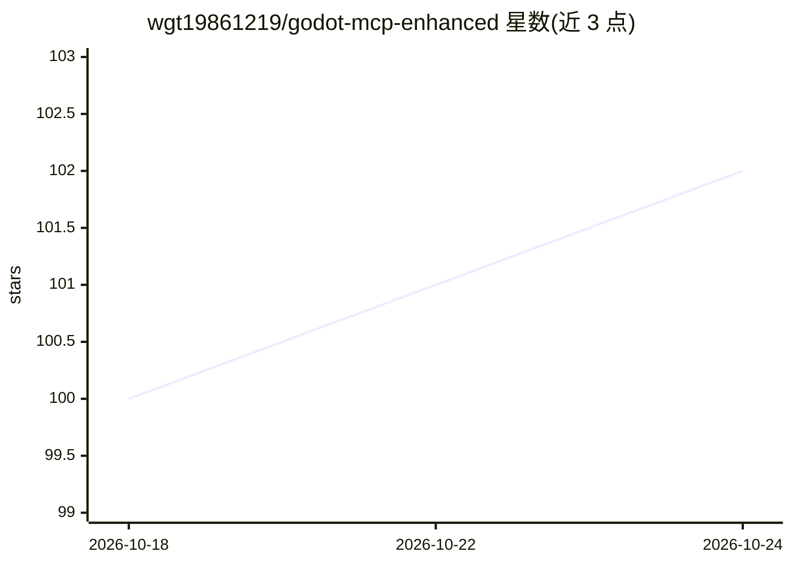

# wgt19861219/godot-mcp-enhanced

⭐ 102 · TypeScript · NOASSERTION · 推送 2026-10-23 · [GitHub](https://github.com/wgt19861219/godot-mcp-enhanced) · [官网](https://godotengine.org/asset-library/asset?user=wgt19861219) · 个人维护 · 中文 README

**面向 AI 客户端的 Godot 4.5-4.7 MCP 工具服务器**

通过 MCP 协议向 Claude Code、Cursor 等 AI 客户端提供 46 个工具（272 个 action），让 AI 读、写、运行、验证 Godot 项目：三层架构（headless CLI / editor WebSocket / game bridge TCP）覆盖静态编辑、实时调试与运行时验证；包含 QA 编排、确定性 playtest（RNG 锁定、条件步进）、路径白名单与注入防御等安全机制，支持 15 个客户端注册。以 npx 分发，可自动安装 Godot 二进制，内置可玩游戏模板、GIF 录制与网页导出。工具描述为简体中文，服务中文 Godot 开发者社区。

## 筛选速览

| 维度 | 判定 | 备注 |
|---|---|---|
| AI 角色 | `ai-ecosystem` | LLM/agent 周边工具 |
| 许可风险 | `none` | NOASSERTION |
| 部署形态 | `library` | 以包/库形式分发 |
| 模型依赖 | — | README 未给出锁定关系 |
| 硬件要求 | — | 无带数字的原话,不猜 |
| 安装摩擦 | `low` | 无编译、无系统依赖或容器化 |
| 成熟度 | — | 结构信号不足 |

## 能力要点

- 三层架构（headless + editor + game bridge）支持运行时控制与输入模拟
- 确定性 playtest：RNG 锁定、fixed_delta、条件步进、snapshot 恢复
- 多层防护：路径白名单、GDScript 注入防御、确认令牌、输出防伪
- 一条命令安装 Godot 二进制，内置可玩模板（2048/贪吃蛇/打砖块）与 QA 套件

## 适用场景

- 让 Claude Code / Cursor 等 AI 客户端直接创建、修改并验证 Godot 游戏项目
- 对 AI 编写的游戏跑确定性自动化测试与交付门禁检查
- 不打开 Godot 编辑器、用一句话让 AI 生成可玩的游戏原型

## 场景标签

 · 领域:游戏开发/AI 工具链

## 证据(README 行号)

> L6: 给 AI(Claude Code、Cursor、CodeBuddy 等 MCP 客户端)一个能真正读、写、跑、验证 Godot 项目的
> L75: **下一步:接入 AI 客户端** — 上面所有能力都经 MCP 提供给 AI 使用。先到 **快速开始** 用一分钟完成配置(Claude Code / Cursor / ZCode / CodeBuddy 等 15 个客户端)

## 星数曲线

2026-10-18 100 → 2026-10-24 102（+2）

---
*卡片 v1 · prompt 1.4 · 生成 2026-10-23 · 置信度 high · 依据 README sha `e700f657ed51` · [字段定义](../../DATASET.md)*
