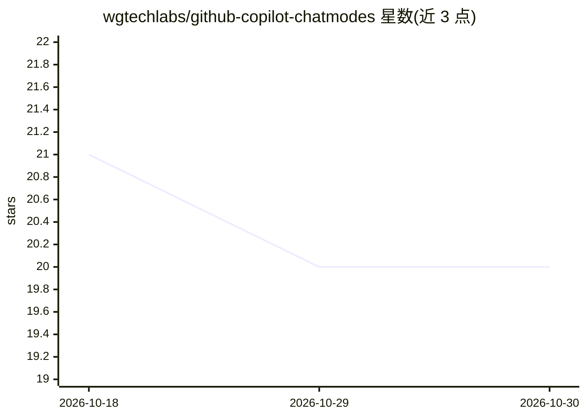

# wgtechlabs/github-copilot-chatmodes

⭐ 20 · MIT · 推送 2026-02-19 · [GitHub](https://github.com/wgtechlabs/github-copilot-chatmodes) · [官网](https://wgtechlabs.com) · 个人维护

**GitHub Copilot 专用聊天模式集合：领域专家型 AI 配置文件**

由 WG Technology Labs 维护的一组 GitHub Copilot Chat Mode 配置文件（.chatmode.md），将 Copilot 转换为领域专属助手。预置 4 个模式：Code Alchemist（Clean Code/SOLID 代码质量）、Code Sentinel（安全审计）、Code Builder（教学向开发）、Code Planner（架构与路线图规划）。安装方式为将文件复制到工作区 .github/chatmodes/ 目录；另提供模板系统与 VS Code 命令供用户自建模式，文件由 frontmatter 中的 description 与 tools 列表定义能力范围。需配合 VS Code 与 GitHub Copilot 使用。

## 筛选速览

| 维度 | 判定 | 备注 |
|---|---|---|
| AI 角色 | `ai-knowledge` | 知识聚合/清单类 |
| 许可风险 | `permissive` | MIT |
| 部署形态 | `None` |  |
| 模型依赖 | — | README 未给出锁定关系 |
| 硬件要求 | — | 无带数字的原话,不猜 |
| 安装摩擦 | `low` | 无编译、无系统依赖或容器化 |
| 成熟度 | — | 结构信号不足 |

## 能力要点

- 预置 4 个领域专家型聊天模式（代码质量/安全/教学/规划）
- 以 .chatmode.md 文件形式安装到 .github/chatmodes/ 目录
- 提供模板与 VS Code 命令创建自定义聊天模式
- 模式文件通过 frontmatter 的 description 与 tools 定义能力

## 适用场景

- 让 Copilot 在代码评审中按 Clean Code 与 SOLID 原则给出建议
- 进行安全审计与漏洞检查时获得针对性指导
- 团队统一使用同一套 AI 专家配置保持方法论一致

## 场景标签

`代码审查` `提示工程` · 领域:Agent 开发

## 证据(README 行号)

> L28: GitHub Copilot Chat Modes transform your AI assistant into domain specialists by providing:
> L46: |Mode|Focus|Best For|Key Features|Path|
> L62:  - Create a `.github/chatmodes/` folder in your VS Code workspace

## 星数曲线

2026-10-18 21 → 2026-10-30 20（-1）

---
*卡片 v1 · prompt 1.4 · 生成 2026-10-28 · 置信度 high · 依据 README sha `9411bc67e2b5` · [字段定义](../../DATASET.md)*
