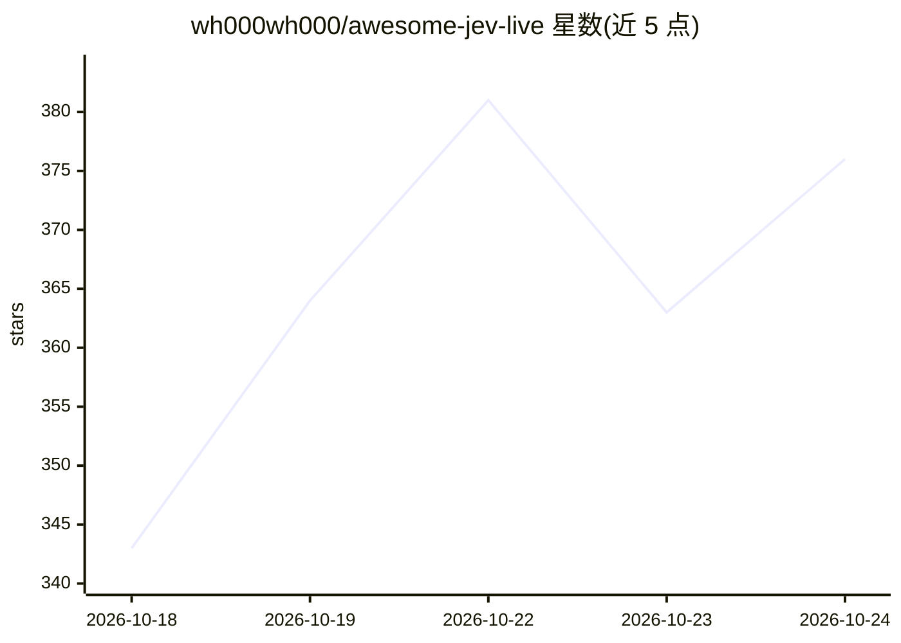

# wh000wh000/awesome-jev-live

⭐ 376 · Python · NOASSERTION · 推送 2026-10-22 · [GitHub](https://github.com/wh000wh000/awesome-jev-live) · [官网](https://wh000wh000.github.io/awesome-jev-live/) · 个人维护 · 中文 README

**每2小时自动重建的 Jev/System One 生态分级索引清单**

围绕 TypeSafe AI 的 System One 模型 Jev 构建的证据分级策展清单：流水线自动采集、过滤并复核条目，每 2 小时重建一次，当前收录 694 个条目、23 种实现语言。条目按 official/observed/inferred/unverified 四级标注核实程度，覆盖官方 SDK、社区客户端与适配器、MCP 工具、agent 与应用等类别，并附星标、最近推送等数据。README 提供多语言版本与条目卡片式的浏览结构。

## 筛选速览

| 维度 | 判定 | 备注 |
|---|---|---|
| AI 角色 | `ai-knowledge` | 知识聚合/清单类 |
| 许可风险 | `none` | NOASSERTION |
| 部署形态 | `library` | 以包/库形式分发 |
| 模型依赖 | — | README 未给出锁定关系 |
| 硬件要求 | — | 无带数字的原话,不猜 |
| 安装摩擦 | `medium` | 含编译或系统依赖之一 |
| 成熟度 | — | 结构信号不足 |

## 能力要点

- 每 2 小时自动重建的动态索引，标注最近同步时间
- 四级证据分级（official/observed/inferred/unverified）标明核实程度
- 收录 694 个条目、23 种实现语言
- 含 What is Jev 说明与各类别优选条目

## 适用场景

- 查找 Jev/System One 的官方 SDK 与社区客户端
- 按证据分级筛选可信度不同的生态项目
- 跟踪 Jev 生态最新新增项目

## 场景标签

 · 领域:AI 生态/知识聚合

## 证据(README 行号)

> L5:  The evidence-graded Jev index that rebuilds itself every two hours.
> L81: Most lists in this space assert inclusion. This one says how much it actually verified, then lets you filter accord

## 星数曲线

2026-10-18 343 → 2026-10-24 376（+33）

---
*卡片 v1 · prompt 1.4 · 生成 2026-10-21 · 置信度 mid · 依据 README sha `432704883c6f` · [字段定义](../../DATASET.md)*
