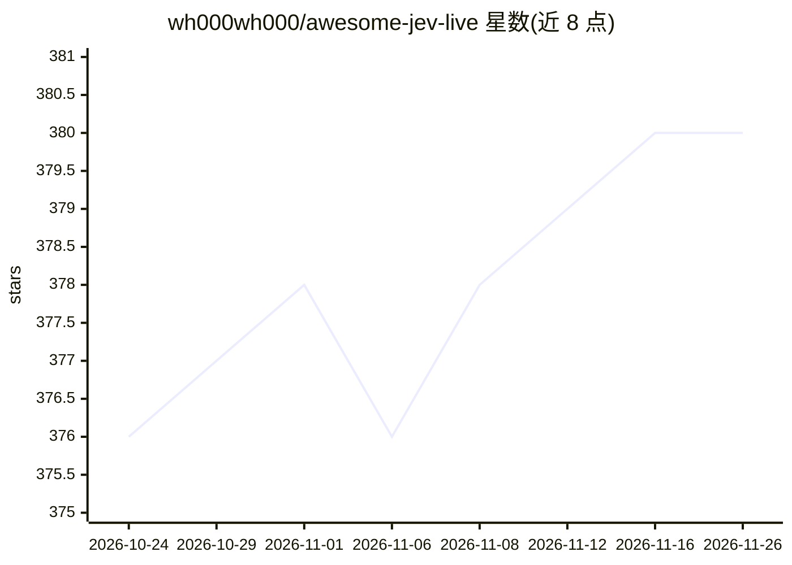

# wh000wh000/awesome-jev-live

⭐ 380 · Python · NOASSERTION · 推送 2026-11-25 · [GitHub](https://github.com/wh000wh000/awesome-jev-live) · [官网](https://wh000wh000.github.io/awesome-jev-live/) · 组织维护 · 中文 README

**Jev/System One 生态的证据分级索引清单，每 2 小时自动重建**

围绕 TypeSafe AI 的 System One 模型 Jev 维护的 awesome 清单：收录 SDK、MCP 工具、agent、应用与开源模型共 802 条，覆盖 26 种实现语言，由仓库内流水线每 2 小时采集、过滤并复核重建。每条按证据分级为 official/observed/inferred/unverified 四档，供用户按验证程度过滤；首页按分级与 star 数重算各分类置顶，并提供 20 种语言的站点版本。

## 筛选速览

| 维度 | 判定 | 备注 |
|---|---|---|
| AI 角色 | `ai-knowledge` | 知识聚合/清单类 |
| 许可风险 | `none` | NOASSERTION |
| 部署形态 | `library` | 以包/库形式分发 |
| 模型依赖 | — | README 未给出锁定关系 |
| 硬件要求 | — | 无带数字的原话,不猜 |
| 安装摩擦 | `medium` | 含编译或系统依赖之一 |
| 成熟度 | — | 结构信号不足 |

## 能力要点

- 802 条条目由流水线每 2 小时自动重建
- 四档证据分级（official/observed/inferred/unverified）可过滤
- 提供 official Python/TypeScript SDK、社区客户端、适配器等分类
- 20 种语言的多语言站点版本

## 适用场景

- 查找接入 Jev System One API 的官方 SDK 与社区客户端
- 按证据分级筛选生态内可信度可核的工具
- 跟踪 Jev 生态新收录条目与分类置顶变化

## 场景标签

`精选清单` · 领域:学习与行业

## 证据(README 行号)

> L5:  The evidence-graded Jev index that rebuilds itself every two hours.
> L20:  Every entry below was collected, filtered and re-checked by the pipeline in this repository. Numbers and timestamp
> L84: |`official`|Published by TypeSafe AI itself.|

## 星数曲线

2026-10-24 376 → 2026-11-26 380（+4）

---
*卡片 v1 · prompt 1.4 · 生成 2026-11-25 · 置信度 mid · 依据 README sha `a1de10f5077e` · [字段定义](../../DATASET.md)*
