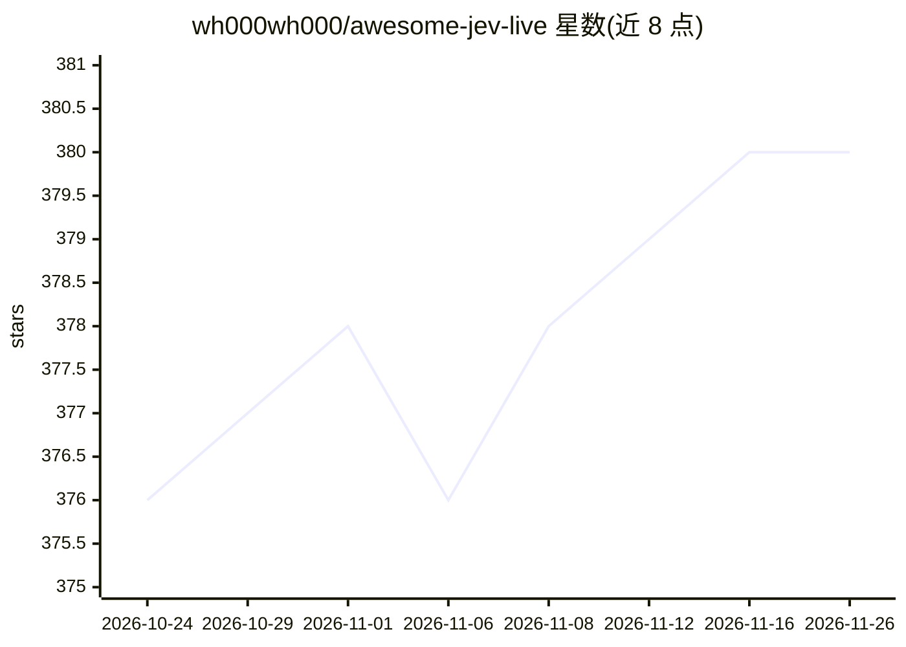

# wh000wh000/awesome-jev-live

⭐ 380 · Python · NOASSERTION · 推送 2026-11-25 · [GitHub](https://github.com/wh000wh000/awesome-jev-live) · [官网](https://wh000wh000.github.io/awesome-jev-live/) · 个人维护 · 中文 README

**面向开发者的 Jev 模型生态分级收录索引，每 2 小时自动重建**

围绕 TypeSafe 的 System One 模型 Jev 构建的自动化清单：流水线每两小时采集并复核条目，当前收录 786 条，覆盖官方 SDK、社区客户端、MCP 工具、agent、应用与开源复现，按 official/observed/inferred/unverified 四级标注验证程度，并以 20 种语言呈现。站点以 MIT 许可发布，条目附带星数、最近推送、首次收录时间等元数据，并明示 Jev 的已知缺陷类别与校准提示。

## 筛选速览

| 维度 | 判定 | 备注 |
|---|---|---|
| AI 角色 | `ai-knowledge` | 知识聚合/清单类 |
| 许可风险 | `none` | NOASSERTION |
| 部署形态 | `library` | 以包/库形式分发 |
| 模型依赖 | — | README 未给出锁定关系 |
| 硬件要求 | — | 无带数字的原话,不猜 |
| 安装摩擦 | `medium` | 含编译或系统依赖之一 |
| 成熟度 | — | 结构信号不足 |

## 能力要点

- 流水线每 2 小时自动重建，条目 786 条、实现语言 26 种
- 四级证据分级（official/observed/inferred/unverified）可过滤
- 每类目按证据等级与星数重算精选条目
- 20 种语言版本，MIT 许可

## 适用场景

- 查找 Jev / TypeSafe System One API 的官方 SDK 与工具
- 按验证程度筛选社区客户端与 MCP 工具
- 跟踪 Jev 生态新增项目（每次更新列出新增条目）

## 场景标签

`精选清单` · 领域:学习与行业

## 证据(README 行号)

> L5:  The evidence-graded Jev index that rebuilds itself every two hours.
> L80: Most lists in this space assert inclusion. This one says how much it actually verified, then lets you filter accord
> L82: |Grade|What it means|

## 星数曲线

2026-10-24 376 → 2026-11-26 380（+4）

---
*卡片 v1 · prompt 1.4 · 生成 2026-11-26 · 置信度 mid · 依据 README sha `e5bd5d05b12b` · [字段定义](../../DATASET.md)*
