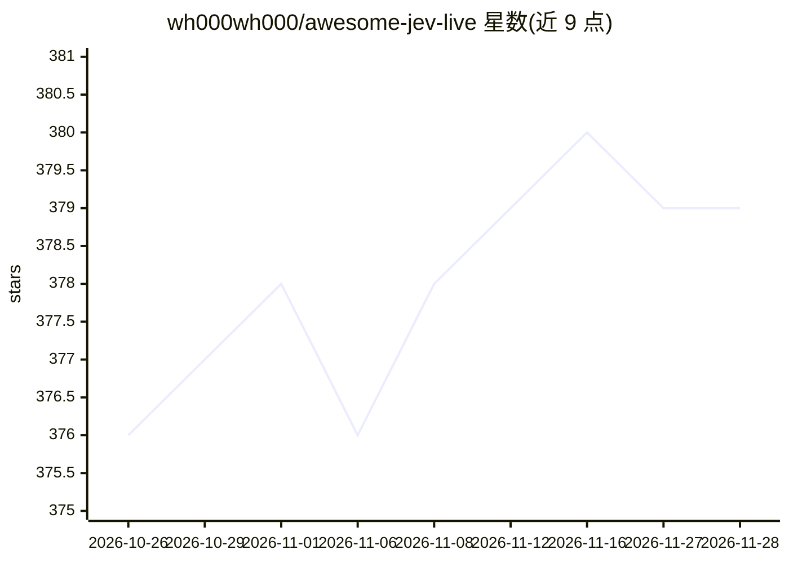

# wh000wh000/awesome-jev-live

⭐ 379 · Python · NOASSERTION · 推送 2026-11-26 · [GitHub](https://github.com/wh000wh000/awesome-jev-live) · [官网](https://wh000wh000.github.io/awesome-jev-live/) · 个人维护 · 中文 README

**Jev/System One 生态的证据分级索引，每两小时自动重建**

围绕 TypeSafe 的 System One 模型 Jev 构建的策展索引：收录 778 个条目，覆盖官方 SDK、社区客户端、MCP 工具、Agent 应用与开源复现，按 official/observed/inferred/unverified 四级证据等级标注验证程度，并列出九类已知缺陷（jaggedness）。索引由仓库内流水线每两小时自动采集重建，条目含星标、语言、更新时间等来自数据源的字段，站点提供 20 种语言界面。内容以清单形式呈现，不含本产品的安装或运行说明。

## 筛选速览

| 维度 | 判定 | 备注 |
|---|---|---|
| AI 角色 | `ai-knowledge` | 知识聚合/清单类 |
| 许可风险 | `none` | NOASSERTION |
| 部署形态 | `library` | 以包/库形式分发 |
| 模型依赖 | — | README 未给出锁定关系 |
| 硬件要求 | — | 无带数字的原话,不猜 |
| 安装摩擦 | `medium` | 含编译或系统依赖之一 |
| 成熟度 | — | 结构信号不足 |

## 能力要点

- 778 个条目按四级证据等级（official/observed/inferred/unverified）分级标注
- 流水线每两小时自动重建，数据来自源头而非手工快照
- 收录官方 SDK、社区客户端、MCP 工具、应用与开源模型等类别
- 界面提供 20 种语言版本

## 适用场景

- 查找接入 TypeSafe Jev System One API 的 SDK 或客户端
- 筛选经源码核验（observed 级）的 Jev 生态工具
- 了解 Jev 模型的已知缺陷类别与官方建议

## 场景标签

`精选清单` · 领域:学习与行业

## 证据(README 行号)

> L5:  The evidence-graded Jev index that rebuilds itself every two hours.
> L68: Jev is TypeSafe AI's first **System One model**. It does not write prose. It takes a state plus questions whose ans
> L84: |`official`|Published by TypeSafe AI itself.|

## 星数曲线

2026-10-26 376 → 2026-11-28 379（+3）

---
*卡片 v1 · prompt 1.4 · 生成 2026-11-27 · 置信度 mid · 依据 README sha `4c32ee6297a1` · [字段定义](../../DATASET.md)*
