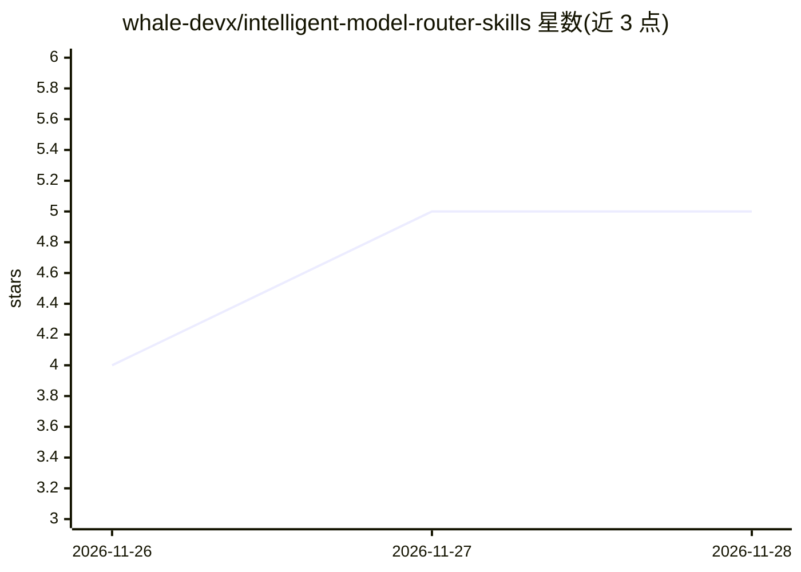

# whale-devx/intelligent-model-router-skills

⭐ 5 · Python · Apache-2.0 · 推送 2026-11-21 · [GitHub](https://github.com/whale-devx/intelligent-model-router-skills) · 个人维护

**给 agent 的模型选型技能：基于清单与证据生成路由决策**

一个 provider 中立的 Agent Skill，安装在 agent 宿主环境中，用于在任务交接或创建子代理前从用户/宿主已有的模型清单中选择模型。工作流为：清单→约束过滤→可比证据→输出可解释的选型计划，缺证据时按 needs_inventory/no_eligible_models/insufficient_evidence 等状态明确弃权。当前为 0.1.0-alpha 离线参考实现：排序为确定性规则，不做账号自动发现、实时榜单导入或执行适配器，helper 本身不调用模型，执行由宿主确认。

## 筛选速览

| 维度 | 判定 | 备注 |
|---|---|---|
| AI 角色 | `ai-ecosystem` | LLM/agent 周边工具 |
| 许可风险 | `permissive` | Apache-2.0 |
| 部署形态 | `library` | 以包/库形式分发 |
| 模型依赖 | — | README 未给出锁定关系 |
| 硬件要求 | — | 无带数字的原话,不猜 |
| 安装摩擦 | `low` | 无编译、无系统依赖或容器化 |
| 成熟度 | `idea` | |

## 能力要点

- 基于宿主/用户提供的模型清单做确定性排序，输出含理由与证据日期的选型计划
- 显式弃权状态：needs_inventory / no_eligible_models / insufficient_evidence
- 离线 alpha：无遥测、无网关、无服务器，helper 不调用模型
- 支持 instruction-only 工作流，Python 仅用于离线示例与测试

## 适用场景

- 让 agent 在创建子代理前为每个任务选择合适的模型
- 在已有模型权限范围内规划模型回退方案
- 评估宿主对路由技能的兼容性并记录测试

## 场景标签

 · 领域:LLM 基础设施/模型路由

## 证据(README 行号)

> L7: A provider-neutral Agent Skill that helps your
> L93: The skill selects **among your available models**, not every model on a leaderboard.
> L94: It is not a provider subscription, inference proxy, or agent runtime.

## 星数曲线

2026-11-26 4 → 2026-11-28 5（+1）

---
*卡片 v1 · prompt 1.4 · 生成 2026-11-26 · 置信度 high · 依据 README sha `90fed0620184` · [字段定义](../../DATASET.md)*
