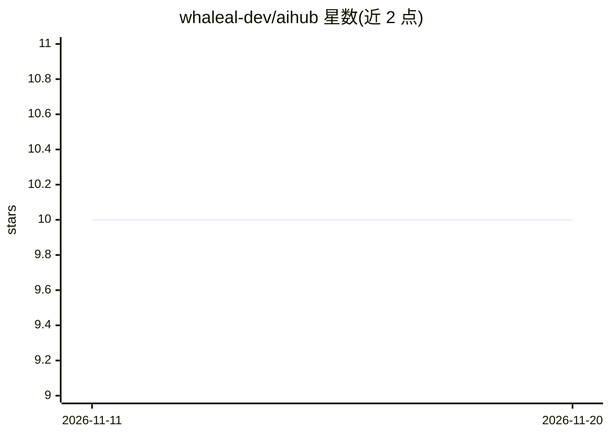

# whaleal-dev/aihub

⭐ 10 · Java · Apache-2.0 · 推送 2026-09-26 · [GitHub](https://github.com/whaleal-dev/aihub) · [官网](http://docs.whaleal.com/aihub/) · 组织维护 · 中文 README

**面向 JDK 8+ 开发者的 Java 大模型统一客户端**

aihub 是一个 Java 大模型客户端库，将各厂商的 HTTP/SSE API 收拢为同一套 Java 调用接口。能力覆盖同步与流式对话、Embedding、图像/音频/视频/音乐/Realtime 等媒体 API、Jina/Ollama/Doubao 重排序，以及 tools/tool_calls 协议字段与鉴权、超时、代理、错误映射等客户端基础设施，并通过 Spring Boot Starter 注入 Spring。README 明确声明范围外不提供 RAG、MCP、Agent 循环、工作流引擎等能力，客户端仅负责发送请求与解析响应。通过 Maven Central 以 Maven/Gradle 依赖方式安装。

## 筛选速览

| 维度 | 判定 | 备注 |
|---|---|---|
| AI 角色 | `ai-ecosystem` | LLM/agent 周边工具 |
| 许可风险 | `permissive` | Apache-2.0 |
| 部署形态 | `None` |  |
| 模型依赖 | local-ok | 支持本地模型 |
| 硬件要求 | — | 无带数字的原话,不猜 |
| 安装摩擦 | `medium` | 含编译或系统依赖之一 |
| 成熟度 | — | 结构信号不足 |

## 能力要点

- 同一套 IChatService 适配 OpenAI、通义、DeepSeek 等多厂商 API
- 支持同步与流式（SSE）对话、Embedding 与媒体 API（图像/音频/视频/音乐/Realtime）
- 提供 Spring Boot Starter 自动配置与 aihub-bom 版本对齐
- 请求携带 tools 字段、响应解析 tool_calls，可选将 @FunctionCall 编成 JSON Schema

## 适用场景

- 在 Java/Spring Boot 项目中统一调用多家大模型 API
- 需要流式对话、文本向量化或重排序接口的 Java 应用
- 切换厂商时只改 PlatformType 与 Config、不改调用代码

## 场景标签

`模型网关` · 领域:Agent 开发

## 证据(README 行号)

> L6: **aihub 是面向 JDK 8+ 的 Java 大模型客户端**，不是 Agent 平台、不是工作流引擎、也不是 RAG 框架。
> L28: |多厂商适配|同一套 `IChatService` 打到 OpenAI、通义、DeepSeek 等|
> L31: |Spring Boot Starter|把上述客户端注入 Spring|

## 星数曲线

2026-11-11 10 → 2026-11-20 10（+0）

---
*卡片 v1 · prompt 1.4 · 生成 2026-11-19 · 置信度 high · 依据 README sha `40764c776e26` · [字段定义](../../DATASET.md)*
