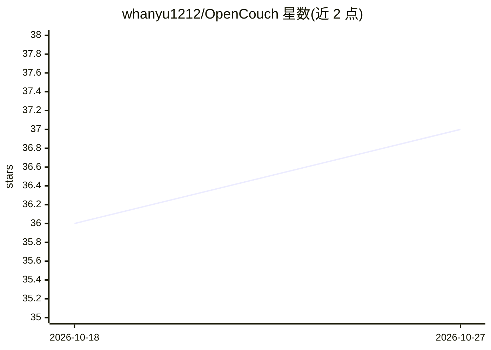

# whanyu1212/OpenCouch

⭐ 37 · Python · AGPL-3.0 · 推送 2026-10-25 · [GitHub](https://github.com/whanyu1212/OpenCouch) · [官网](https://whanyu1212.github.io/OpenCouch/) · 个人维护

**心理自助聊天陪伴应用：情绪支持、引导练习与持久记忆**

面向日常情绪支持与自我反思的聊天陪伴产品：文本运行时基于 OpenAI Agents SDK 与 FastAPI，Postgres 持久化会话与三层记忆（语义/情景/程序性），每轮生成前做安全分类，可移交危机处理 agent 并留存审计日志；内置 13 个多轮引导练习（着陆、呼吸、认知作业等）。提供 Next.js 网页端与文本 TUI，语音走 OpenAI Realtime（pre-beta）。项目自述处于 pre-beta 稳定期，明确声明不能替代专业心理治疗或紧急服务。

## 筛选速览

| 维度 | 判定 | 备注 |
|---|---|---|
| AI 角色 | `ai-native` | 本体是模型或模型工具 |
| 许可风险 | `viral` | AGPL-3.0 |
| 部署形态 | `self-host` | docker 或自建部署 |
| 模型依赖 | — | README 未给出锁定关系 |
| 硬件要求 | — | 无带数字的原话,不猜 |
| 安装摩擦 | `low` | 无编译、无系统依赖或容器化 |
| 成熟度 | `idea` | |

## 能力要点

- 三层持久记忆（CoALA 启发）+ 每轮安全路由与危机审计日志
- 13 个带同意与步骤状态跟踪的多轮引导练习
- Next.js 网页聊天与文本 TUI 双端，共用同一 FastAPI 运行时
- 1100+ 后端测试与 OpenTelemetry 可观测性

## 适用场景

- 日常情绪记录与自我反思的陪伴式对话
- 按步骤完成着陆、呼吸等应对练习
- 长期使用中保持跨会话的记忆连续性

## 场景标签

`聊天机器人` `Agent 记忆` · 领域:Agent 开发

## 证据(README 行号)

> L3: **A chat mental health companion that supports your well-being through reflection, guided exercises, and a memory th
> L27: OpenCouch is a chat companion for day-to-day emotional support, self-reflection, and practical coping. The text run
> L33: - **Structured coping flows** — 13 multi-turn guided exercises (grounding, breathing, thought work, values) with co

## 星数曲线

2026-10-18 36 → 2026-10-27 37（+1）

---
*卡片 v1 · prompt 1.4 · 生成 2026-10-25 · 置信度 mid · 依据 README sha `920a0a677c76` · [字段定义](../../DATASET.md)*
