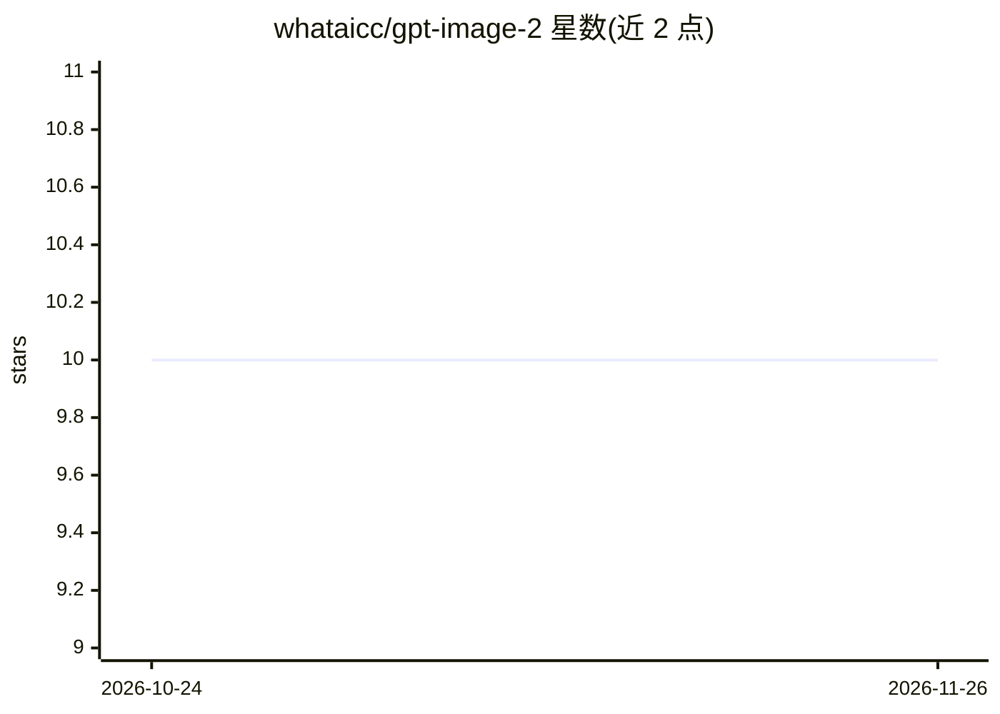

# whataicc/gpt-image-2

⭐ — · [GitHub]() · 组织维护 · 中文 README

**面向国内开发者的 gpt-image-2 中转 API 接入服务**

该仓库为神马中转 API（api.whatai.cc）的介绍页：将 GPT-Image-2 的图像生成与编辑请求统一经由一个中转入口调用，使用统一的 API Key 和接口格式，面向无法直接访问 OpenAI 官方 API 或无海外网络环境的国内用户。平台同时聚合 OpenAI、Anthropic、Google Gemini、Midjourney 等模型接口。README 包含 Python 调用示例、模型功能介绍（多语言文本渲染、多种宽高比、thinking 模式）、官方与中转价格对照，并提及可通过机灵助手小程序免费测试。

## 筛选速览

| 维度 | 判定 | 备注 |
|---|---|---|
| AI 角色 | `ai-ecosystem` | LLM/agent 周边工具 |
| 许可风险 | `none` | — |
| 部署形态 | `None` |  |
| 模型依赖 | — | README 未给出锁定关系 |
| 硬件要求 | — | 无带数字的原话,不猜 |
| 安装摩擦 | `low` | 无编译、无系统依赖或容器化 |
| 成熟度 | — | 结构信号不足 |

## 能力要点

- 统一 API Key 与接口格式调用 GPT-Image-2 图像生成与编辑
- 国内直连，无需海外网络环境或单独对接 OpenAI 官方 API
- 聚合 OpenAI、Anthropic、Google Gemini、Midjourney 等模型调用接口
- 提供 Python 请求示例与官方/中转价格对照

## 适用场景

- 在国内网络环境下调用 gpt-image-2 生成和编辑图像
- 用一个 API Key 统一接入多家模型服务商的接口
- 将图像生成能力集成到自己的产品或工作流中

## 场景标签

`图像生成` `模型网关` · 领域:Agent 开发

## 证据(README 行号)

> L3: 通过神马中转API（api.whatai.cc），你可以将所有对 GPT-Image-2的请求 统一走一个稳定的中转服务入口，无需单独对接 OpenAI 官方 API、处理复杂网络限制或配置海外网络环境。作为一站式 AI 大模型中转
> L9: 神马中转API请求GPT-image-2示例：

## 星数曲线

2026-10-24 10 → 2026-11-26 10（+0）

---
*卡片 v1 · prompt 1.4 · 生成 2026-11-19 · 置信度 high · 依据 README sha `8edacb484fa8` · [字段定义](../../DATASET.md)*
