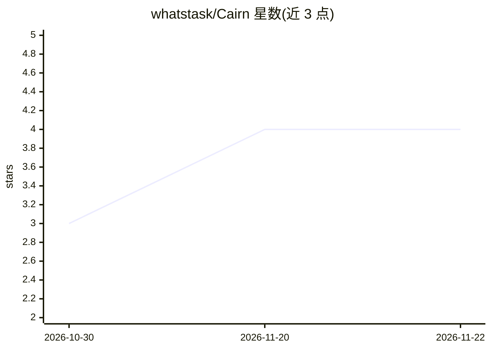

# whatstask/Cairn

⭐ 4 · Rust · Apache-2.0 · 推送 2026-11-16 · [GitHub](https://github.com/whatstask/Cairn) · 个人维护

**给 Rust 开发者的持久化、可治理、模型无关的 agent 框架**

用 Rust 编写的 agent 框架与网关：每次模型调用、工具调用、审批与策略决策追加到事件日志，agent 状态由日志折叠得出，从而以同一代码路径实现执行、崩溃恢复、人工审批与时间旅行调试。提供 OpenAI/Anthropic 兼容的 drop-in 网关（预算、模型白名单、跨提供商 failover、审计）、Postgres 日志与租约、工作流编排、MCP/A2A 协议、OpenTelemetry 输出与基于回放的评测。v0.1 早期版本，公开 API 在 1.0 前可能变更；需 Rust 1.87+。

## 筛选速览

| 维度 | 判定 | 备注 |
|---|---|---|
| AI 角色 | `ai-ecosystem` | LLM/agent 周边工具 |
| 许可风险 | `permissive` | Apache-2.0 |
| 部署形态 | `library` | 以包/库形式分发 |
| 模型依赖 | local-ok | 支持本地模型 |
| 硬件要求 | — | 无带数字的原话,不猜 |
| 安装摩擦 | `low` | 无编译、无系统依赖或容器化 |
| 成熟度 | `idea` | |

## 能力要点

- 事件日志驱动的持久执行：恢复、回放、审计与评测均由日志派生
- OpenAI/Anthropic 兼容网关：per-key 预算、模型白名单、跨提供商 failover
- MCP 客户端与 A2A 1.0 服务/客户端，工具按 Read/Write/Irreversible 声明副作用
- 硬预算控制：步骤、token、USD 在每次模型调用前强制执行

## 适用场景

- 在现有 LangGraph/OpenAI SDK 应用上改一行接入带预算与审计的网关
- 构建需崩溃恢复与人工审批的长时 agent 工作流
- 基于生产运行记录做回放式评测而不重复副作用
- 通过 A2A 协议让其他框架/公司的 agent 互相调用

## 场景标签

`Agent 框架` `模型网关` `工作流自动化` `模型评测` · 领域:Agent 开发

## 证据(README 行号)

> L9: Durable, governed, model-agnostic AI agents, written in Rust.
> L34: Change one line in your existing app (LangGraph, CrewAI, OpenAI Agents SDK, Vercel AI SDK,
> L241: |`cairn-gateway`|Drop-in OpenAI/Anthropic-compatible gateway: budgets, allowlists, failover, audit|

## 星数曲线

2026-10-30 3 → 2026-11-22 4（+1）

---
*卡片 v1 · prompt 1.4 · 生成 2026-11-21 · 置信度 high · 依据 README sha `8fa9341e0230` · [字段定义](../../DATASET.md)*
