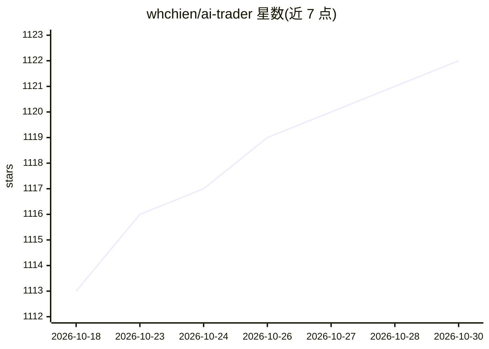

# whchien/ai-trader

⭐ 1,122 · Python · GPL-3.0 · 推送 2026-03-28 · [GitHub](https://github.com/whchien/ai-trader) · 个人维护 · 中文 README

**面向专业交易者的 Backtrader 回测框架，含 MCP 服务集成**

基于 Backtrader 构建的配置驱动量化回测框架：以 YAML 文件定义回测、20+ 内置策略、覆盖美股/台股/加密货币/外汇市场，提供 CLI（run/fetch/quick）下载历史数据（CSV 或 SQLite 缓存）并执行回测。AI 部分：内置 MCP 服务器，使 Claude 等 AI 助手可用自然语言运行回测、抓取数据、列出策略；另提供 Claude Code 的 /add-strategy 技能引导创建自定义策略。以 PyPI 包或源码方式安装，GPL-3.0 许可。

## 筛选速览

| 维度 | 判定 | 备注 |
|---|---|---|
| AI 角色 | `ai-enhanced` | 去掉 AI 部分产品仍成立 |
| 许可风险 | `viral` | GPL-3.0 |
| 部署形态 | `library` | 以包/库形式分发 |
| 模型依赖 | — | README 未给出锁定关系 |
| 硬件要求 | — | 无带数字的原话,不猜 |
| 安装摩擦 | `low` | 无编译、无系统依赖或容器化 |
| 成熟度 | — | 结构信号不足 |

## 能力要点

- YAML 配置驱动的可复现回测工作流
- 内置 MCP 服务器，Claude 等助手可自然语言操作回测引擎
- 20+ 内置策略，支持美股/台股/加密货币/外汇
- CLI 抓取市场数据并以 CSV 或 SQLite 持久化缓存

## 适用场景

- 用 YAML 配置文件可复现地运行策略回测
- 让 Claude 通过自然语言执行回测、取数和策略分析
- 在 Python 项目中以库形式集成回测能力

## 场景标签

`金融量化` · 领域:学习与行业

## 证据(README 行号)

> L8: A professional, config-driven backtesting framework for algorithmic trading, built on Backtrader. Seamlessly test, o
> L15: - **Seamless LLM Integration**: Built-in MCP (Model Context Protocol) server allows AI assistants like Claude to ru
> L120: Run `ai-trader` as a server to let AI assistants interact with your backtesting engine.

## 星数曲线

2026-10-18 1,113 → 2026-10-30 1,122（+9）

---
*卡片 v1 · prompt 1.4 · 生成 2026-10-21 · 置信度 high · 依据 README sha `eb2823b11cd0` · [字段定义](../../DATASET.md)*
