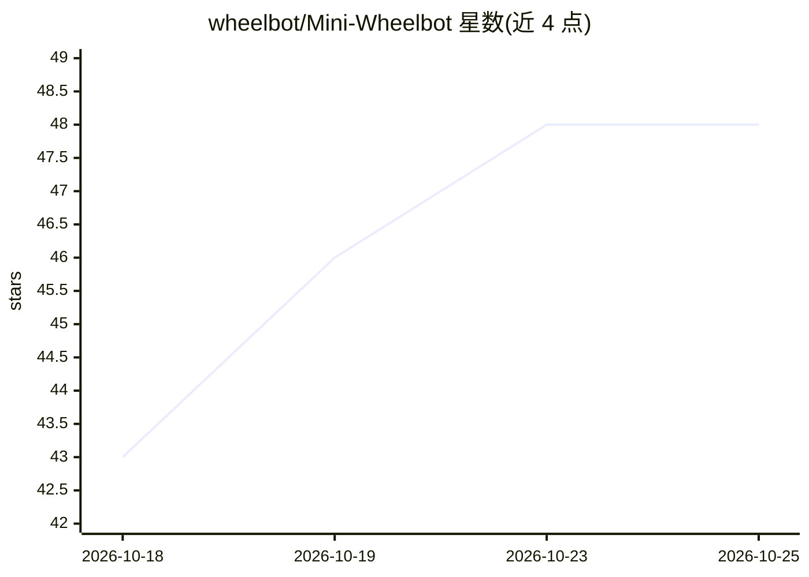

# wheelbot/Mini-Wheelbot

⭐ 48 · C · 推送 2026-09-30 · [GitHub](https://github.com/wheelbot/Mini-Wheelbot) · 组织维护

**学习型控制研究的自平衡单轮机器人测试平台**

反应轮驱动的自平衡独轮机器人硬件与研究平台：具有不稳定、强非线性偏航动力学、非完整驱动与离散接触切换等特性，可用轮子从任意初始姿态自行站立，支持实验中的自动环境复位。仓库提供 PCB 原理图、可视化网格、Buildroot Linux 上的 C++20 代码、系统辨识与键盘控制等 Python 脚本、Acados 仿真及 STM32 微控制器软件。配套论文发表于 ICRA 2025，相关仓库含基于 JAX 的偏航神经网络近似 MPC 训练。

## 筛选速览

| 维度 | 判定 | 备注 |
|---|---|---|
| AI 角色 | `ai-enhanced` | 去掉 AI 部分产品仍成立 |
| 许可风险 | `none` | — |
| 部署形态 | `None` |  |
| 模型依赖 | — | README 未给出锁定关系 |
| 硬件要求 | — | 无带数字的原话,不猜 |
| 安装摩擦 | `low` | 无编译、无系统依赖或容器化 |
| 成熟度 | — | 结构信号不足 |

## 能力要点

- 自平衡反应轮独轮机器人，可从任意初始姿态自行站立
- 提供 PCB 原理图、C++20 固件、STM32 微控制器软件
- Acados 动力学仿真与系统辨识 Python 脚本
- ICRA 2025 论文配套的重复实验自动复位能力

## 适用场景

- 在学习型控制研究中做真实硬件实验验证
- 利用其非线性不稳定动力学测试控制算法
- 复现或扩展 ICRA 2025 论文中的平衡与翻转实验

## 场景标签

 · 领域:机器人/控制

## 证据(README 行号)

> L3: The Mini Wheelbot is a **balancing, reaction wheel
> L4: unicycle robot** designed as a testbed for learning-based control.
> L35: - **Wheelbot-Lib**: C++20 code running on the Mini Wheelbots Buildroot Linux

## 星数曲线

2026-10-18 43 → 2026-10-25 48（+5）

---
*卡片 v1 · prompt 1.4 · 生成 2026-10-25 · 置信度 mid · 依据 README sha `53ab87b98b24` · [字段定义](../../DATASET.md)*
