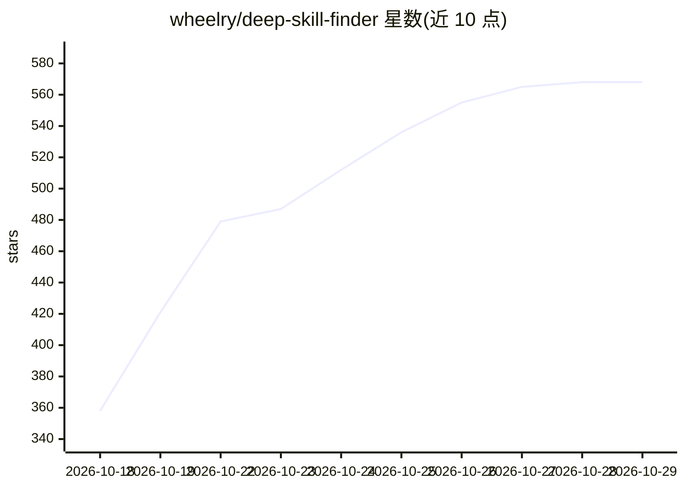

# wheelry/deep-skill-finder

⭐ 568 · Python · 推送 2026-10-12 · [GitHub](https://github.com/wheelry/deep-skill-finder) · [官网](https://www.deepskill.market?ref=github) · 个人维护 · 中文 README

**给 AI Agent 用的技能发现引擎：从 20 万技能中检索并按实测反馈排序**

以 Claude Code、Codex、Cursor 等 40+ Agent 运行时为宿主的技能（Skill）发现工具：Agent 在任务需要外部技能时自动触发，理解任务意图后从全网的技能生态中检索候选，结合真实用户评审（记录使用场景、执行结果、Token 成本、失败情况）进行 8 层两阶段排序，输出最多 5 个带理由的推荐，确认后自动安装。也提供可独立运行的 Python 搜索/安装/卸载脚本。安装方式为向 Agent 发送安装提示或下载 deepskill.market 提供的技能包。

## 筛选速览

| 维度 | 判定 | 备注 |
|---|---|---|
| AI 角色 | `ai-ecosystem` | LLM/agent 周边工具 |
| 许可风险 | `permissive` | — |
| 部署形态 | `None` |  |
| 模型依赖 | — | README 未给出锁定关系 |
| 硬件要求 | — | 无带数字的原话,不猜 |
| 安装摩擦 | `low` | 无编译、无系统依赖或容器化 |
| 成熟度 | — | 结构信号不足 |

## 能力要点

- 任务意图理解 + 真实用户评审的两阶段 8 层排序
- 输出最多 5 个带理由、含风险提示的推荐并自动安装
- 兼容 Claude Code / Codex / Cursor 等 40+ Agent 运行时
- 提供可独立运行的 Python 搜索/安装/卸载脚本

## 适用场景

- 让 Agent 在执行任务时自动找到并安装合适的外部技能
- 在名称检索难以判断优劣时，参考相似场景的真实执行反馈选择技能
- 安装前获知技能的凭据需求、失败记录与成本等风险信息

## 场景标签

 · 领域:Agent 基础设施/技能发现

## 证据(README 行号)

> L5: *An Agentic skill discovery engine. Your Claude Code / Codex / OpenClaw / Cursor auto-discovers the right skill from
> L29: Talk to your Agent naturally. When a task needs an external Skill, DSF triggers automatically:
> L146: This forms a complete recommendation loop: **task understanding → multi-channel recall → merge & coarse ranking → 

## 星数曲线

2026-10-18 358 → 2026-10-29 568（+210）

---
*卡片 v1 · prompt 1.4 · 生成 2026-10-21 · 置信度 high · 依据 README sha `98b82bb644b2` · [字段定义](../../DATASET.md)*
