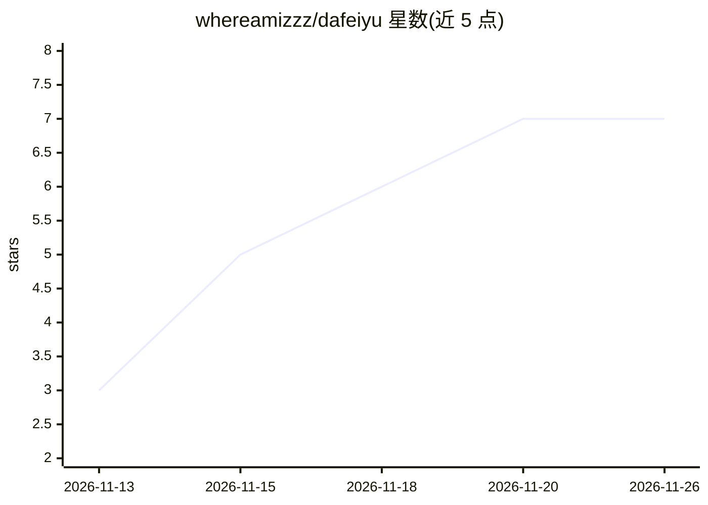

# whereamizzz/dafeiyu

⭐ 7 · Python · MIT · 推送 2026-10-26 · [GitHub](https://github.com/whereamizzz/dafeiyu) · 个人维护 · 中文 README

**本地运行的微信群聊机器人：接话、插话、人格与情绪控制台**

基于 Windows 桌面微信的 AI 聊天机器人，通过 UIA 界面自动化读写微信窗口、轮询本地数据库收消息，在指定群聊/私聊中自动回复。核心机制包括每条消息 0-10 分判分门禁、主动接话与人格/心情/记忆系统、语音经本地 faster-whisper 转写、单文件网页控制台（FastAPI 后端仅监听 127.0.0.1）。限制：仅支持 Windows 10/11，需一台常开电脑，发送消息时会短暂占用前台窗口与鼠标，存在账号被限制的风险，README 建议使用小号。

## 筛选速览

| 维度 | 判定 | 备注 |
|---|---|---|
| AI 角色 | `ai-native` | 本体是模型或模型工具 |
| 许可风险 | `permissive` | MIT |
| 部署形态 | `desktop` | 安装包/桌面程序 |
| 模型依赖 | locked-api |  |
| 硬件要求 | — | 无带数字的原话,不猜 |
| 安装摩擦 | `low` | 无编译、无系统依赖或容器化 |
| 成熟度 | — | 结构信号不足 |

## 能力要点

- 消息判分 + 并发/频率硬限制门禁，判定理由记录在控制台
- 人格模板 base.md 可编辑，心情值与群聊/私聊记忆
- 链接/图片/语音/卡片消息解析（语音走本地 faster-whisper）
- 三层看门狗自愈与单文件零外部依赖网页控制台

## 适用场景

- 在自己电脑上养一个会聊天的微信群聊小号
- 群里冷场时让机器人自动起话题
- 通过中文控制台给不懂代码的人配置聊天机器人

## 场景标签

`聊天机器人` · 领域:对话与助手

## 证据(README 行号)

> L14: 大肥鱼是一个跑在 **Windows 桌面微信**上的 AI 助手。它用系统自带的界面自动化（UIA）读微信窗口、用数据库轮询收消息，然后在**你指定的群和私聊**里像正常人一样接话、答问题、陪聊、发图。
> L49: 链接会去读标题和摘要再评论；图片和表情包需要打开识图（支持智谱 GLM 等），不开就只记一句「[图片]」；语音走本地 faster-whisper 转文字；微信的卡片消息会解析出卡片标题再判断要不要接。

## 星数曲线

2026-11-13 3 → 2026-11-26 7（+4）

---
*卡片 v1 · prompt 1.4 · 生成 2026-11-20 · 置信度 high · 依据 README sha `354f627c678d` · [字段定义](../../DATASET.md)*
