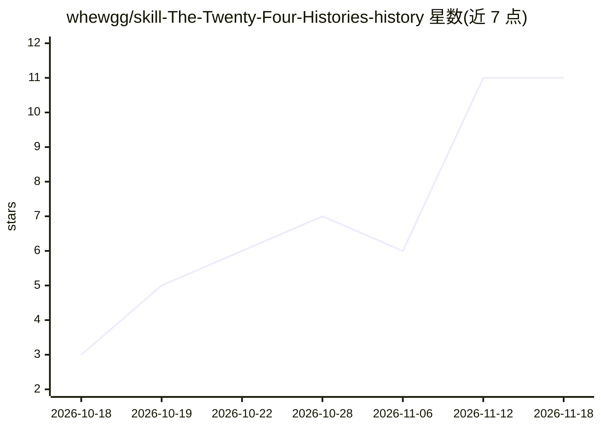

# whewgg/skill-The-Twenty-Four-Histories-history

⭐ 11 · Python · AGPL-3.0 · 推送 2026-10-26 · [GitHub](https://github.com/whewgg/skill-The-Twenty-Four-Histories-history) · [官网](https://whewgg.github.io/skill-The-Twenty-Four-Histories-history/) · 个人维护 · 中文 README

**供 LLM 使用的二十六史与资治通鉴文白对照检索技能库**

以 SKILL.md 形式发布的中文古籍检索技能：内置《资治通鉴》与二十六史共 27 部 4408 卷 Markdown 语料（246.9 MB），配 Python 检索脚本 rag.py 提供证据块定位、引文核验、人物字号/出现索引、帝王本纪锚点、表卷 OCR 机读稿路由与朝代同名异代消歧；另含讲史抽签与辨伪清单。面向接入该技能的 LLM 使用者，要求先检索后回答、引文照录、查不到即报未载。仅覆盖 1840 年前中国正史与通鉴范围。

## 筛选速览

| 维度 | 判定 | 备注 |
|---|---|---|
| AI 角色 | `ai-knowledge` | 知识聚合/清单类 |
| 许可风险 | `viral` | AGPL-3.0 |
| 部署形态 | `None` |  |
| 模型依赖 | — | README 未给出锁定关系 |
| 硬件要求 | — | 无带数字的原话,不猜 |
| 安装摩擦 | `low` | 无编译、无系统依赖或容器化 |
| 成熟度 | — | 结构信号不足 |

## 能力要点

- 27 部 4408 卷文白对照 Markdown 全文，目录可整体搬移
- rag.py 一次调用返回带出处与原文/译文判定的证据块，verify 子命令做交付前引文核验
- 人物字号索引 4.06 万条、人物出现倒排 1.32 万人、案件/表卷/帝王本纪等索引体系
- 朝代同名异代消歧规则与讲史抽签脚本 pick_story.py

## 适用场景

- 让 LLM 回答人物事迹、官制、原文出处等正史问题时先查库再作答
- 核验 LLM 生成的文言引文与书卷出处是否真实存在于库中
- 按抽签流程让 LLM 讲述正史故事并规避虚构混叙
- 定位某人物专传、某案件或某表卷数据的原始出处

## 场景标签

`RAG` `科研工具` · 领域:知识与检索

## 证据(README 行号)

> L7: 《资治通鉴》＋二十六史，27 部 4408 卷 Markdown 全文，放在本 skill 目录下的 `data\`（**本文档与全部脚本都不写死盘符／绝对路径，整个 skill 目录可整体搬移**）。本文件只讲**怎么决定**；数
> L63: **默认走 `rag.py`——它把"检索"和"防瞎编"合成一步**：一次调用返回若干**证据块**，每块自带
> L110: ## 索引体系（含「问什么 → 去哪」路由）

## 星数曲线

2026-10-18 3 → 2026-11-18 11（+8）

---
*卡片 v1 · prompt 1.4 · 生成 2026-11-18 · 置信度 mid · 依据 README sha `dd0f4eb2d630` · [字段定义](../../DATASET.md)*
