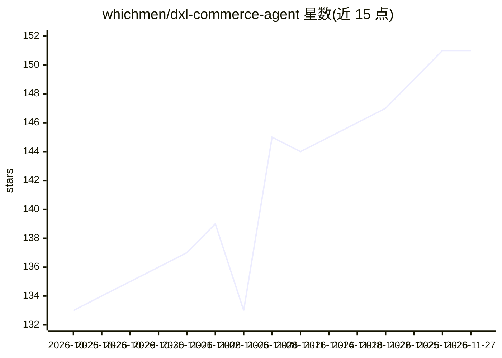

# whichmen/dxl-commerce-agent

⭐ 151 · Python · MIT · 推送 2026-11-14 · [GitHub](https://github.com/whichmen/dxl-commerce-agent) · 个人维护 · 中文 README

**给电商商家：多平台客服自动回复的 LLM Agent 系统**

一套接入淘宝、拼多多、抖音、快手、小红书、视频号六个电商平台的客服自动化系统。主链路由 OpenClaw + 大模型理解顾客消息、按业务规则调用 13 个订单/物流/退款/图像等工具查询真实业务数据后生成回复。接入层统一浏览器（Chrome CDP/Playwright）与手机端（Appium、Android 无障碍）消息事件；用 SQLite 保存会话与发送回执，支持消息去重、人工接管、watchdog 恢复与 50 条离线 Eval。需自备模型账号、ERP 授权与 Android 环境，Docker 链路仅验证固定规则降级模式。

## 筛选速览

| 维度 | 判定 | 备注 |
|---|---|---|
| AI 角色 | `ai-native` | 本体是模型或模型工具 |
| 许可风险 | `permissive` | MIT |
| 部署形态 | `self-host` | docker 或自建部署 |
| 模型依赖 | — | README 未给出锁定关系 |
| 硬件要求 | — | 无带数字的原话,不猜 |
| 安装摩擦 | `low` | 无编译、无系统依赖或容器化 |
| 成熟度 | — | 结构信号不足 |

## 能力要点

- 六个平台接入代码：浏览器 CDP/Playwright 与 Appium、Android AccessibilityService
- 13 个 Agent 工具，默认仅开放 4 个只读查询，高风险工具需显式开关
- 会话串行处理、消息去重、发送回执与 watchdog 自动恢复
- 72 项自动化测试与 50 条确定性离线 Eval

## 适用场景

- 自动回复店铺的售前、物流和售后咨询
- 让模型查真实订单数据后生成客服回复而非凭记忆作答
- 高风险操作关闭时人工接管客服会话

## 场景标签

`浏览器自动化` `模型评测` `聊天机器人` · 领域:效率与自动化

## 证据(README 行号)

> L3: 这是我做的一套完整电商客服自动化系统。它不是靠规则 Planner 拼固定话术：默认主链路由 **OpenClaw + 大模型**理解顾客问题、结合上下文选择工具、查询真实业务数据，再生成可以直接发送的回复。
> L5: 项目把平台消息接入、浏览器和手机操控、Agent、订单与物流工具、售后风控、会话记忆、发送回执、异常恢复、运行监控和 Eval 放在了一个仓库里。
> L62: 默认的 `CLAWBOT_DECISION_MODE=agent` 会走下面这条链路：

## 星数曲线

2026-10-25 133 → 2026-11-27 151（+18）

---
*卡片 v1 · prompt 1.4 · 生成 2026-11-27 · 置信度 high · 依据 README sha `fc962363b2c0` · [字段定义](../../DATASET.md)*
