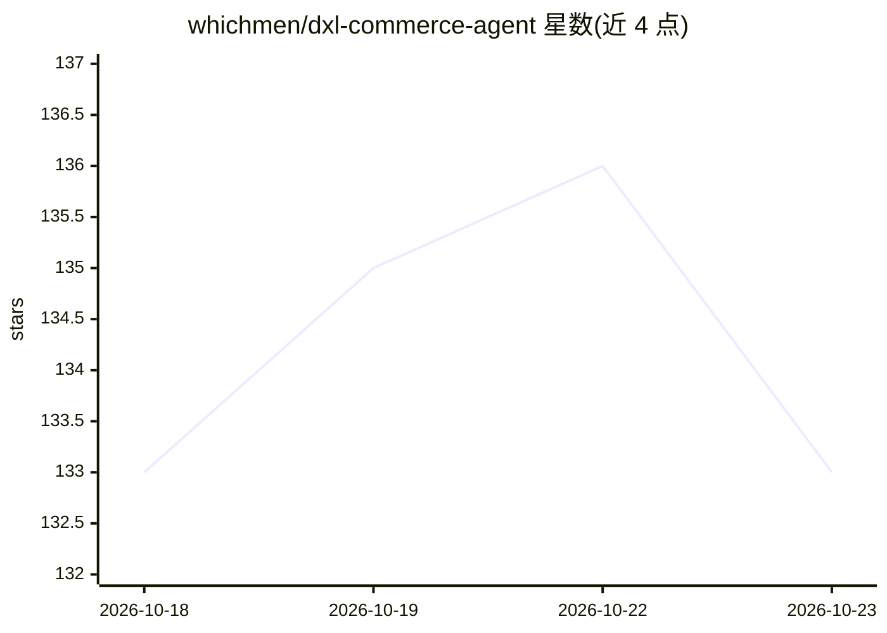

# whichmen/dxl-commerce-agent

⭐ 133 · Python · MIT · 推送 2026-10-15 · [GitHub](https://github.com/whichmen/dxl-commerce-agent) · 个人维护 · 中文 README

**六平台电商客服自动化系统：大模型 Agent 自动回复买家**

面向淘宝、拼多多、抖音、快手、小红书、视频号六个平台的电商客服自动化系统：各平台浏览器端（Chrome CDP/Playwright）与手机端（Appium/UiAutomator2/Android 无障碍）Worker 统一接收消息，交由 OpenClaw + 大模型 Agent 结合会话记忆与 kefu-core 业务规则，通过 13 个工具查询订单、物流、退款等真实数据后生成回复并发回平台。默认仅注册 4 个只读工具，9 个高风险工具需显式开启；按会话串行处理并做去重、幂等与发送回执，SQLite 存储状态，支持人工接管、watchdog 恢复、离线 Eval 与 CI。Docker Compose 仅跑无模型的策略降级链路。

## 筛选速览

| 维度 | 判定 | 备注 |
|---|---|---|
| AI 角色 | `ai-native` | 本体是模型或模型工具 |
| 许可风险 | `permissive` | MIT |
| 部署形态 | `self-host` | docker 或自建部署 |
| 模型依赖 | — | README 未给出锁定关系 |
| 硬件要求 | — | 无带数字的原话,不猜 |
| 安装摩擦 | `low` | 无编译、无系统依赖或容器化 |
| 成熟度 | — | 结构信号不足 |

## 能力要点

- 六平台浏览器端与手机端消息接入统一处理
- OpenClaw 原生 Function Calling 调用 13 个业务工具（默认只开 4 个只读）
- 会话串行、消息去重、幂等键、发送回执与人工接管协议
- 72 项自动化测试、50 条确定性离线 Eval 与 CI

## 适用场景

- 多平台电商店铺自动回复售前、物流与售后问题
- 让 Agent 查询真实订单/退款数据后生成可发送回复
- 人工接管高风险或异常会话

## 场景标签

 · 领域:电商客服自动化

## 证据(README 行号)

> L3: 这是我做的一套完整电商客服自动化系统。它不是靠规则 Planner 拼固定话术：默认主链路由 **OpenClaw + 大模型**理解顾客问题、结合上下文选择工具、查询真实业务数据，再生成可以直接发送的回复。
> L15: - 让大模型根据 `kefu-core` 业务规则和最近对话自行判断是否查单、查物流、查退款记录或核验售后；
> L71: 这里的大模型不是装饰：

## 星数曲线

2026-10-18 133 → 2026-10-23 133（+0）

---
*卡片 v1 · prompt 1.4 · 生成 2026-10-22 · 置信度 mid · 依据 README sha `f49cc4e7300b` · [字段定义](../../DATASET.md)*
