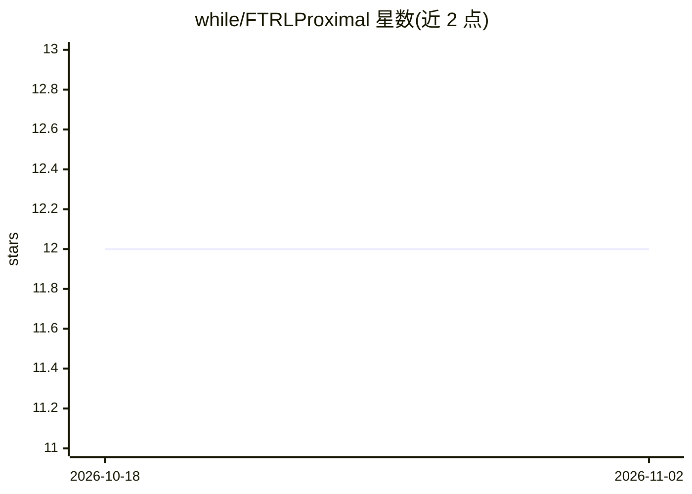

# while/FTRLProximal

⭐ 12 · R · NOASSERTION · 推送 2026-05-18 · [GitHub](https://github.com/while/FTRLProximal) · 个人维护

**R 包：FTRL Proximal 算法在线训练弹性网逻辑回归**

R 语言包，实现 FTRL Proximal 算法用于弹性网逻辑回归模型的在线学习，算法出处为 McMann 等人 2013 年论文 Ad Click Prediction: a View from the Trenches。使用方式类似常规 glm 的模型公式接口，支持训练后对已有模型对象进行增量更新，并支持 class 类型预测。通过 CRAN 或 devtools 从 GitHub 安装，最低要求 R 3.5.0，含 C 源码（通过 CRAN 注册原生例程）。

## 筛选速览

| 维度 | 判定 | 备注 |
|---|---|---|
| AI 角色 | `ai-native` | 本体是模型或模型工具 |
| 许可风险 | `none` | NOASSERTION |
| 部署形态 | `None` |  |
| 模型依赖 | — | README 未给出锁定关系 |
| 硬件要求 | — | 无带数字的原话,不猜 |
| 安装摩擦 | `low` | 无编译、无系统依赖或容器化 |
| 成熟度 | — | 结构信号不足 |

## 能力要点

- FTRL Proximal 在线学习弹性网逻辑回归
- 支持对已训练模型对象的增量更新
- glm 式模型公式接口，支持 class 预测类型
- 发布于 CRAN，含 C 源码实现

## 适用场景

- 用 R 在线训练逻辑回归模型
- 对新数据流式增量更新已有模型
- 广告点击预测类稀疏特征的在线学习实验

## 场景标签

 · 领域:机器学习/统计建模

## 证据(README 行号)

> L7: This is an R package of the FTRL Proximal algorithm for online learning of elastic net logistic regression models.
> L9: For more info on the algorithm please see Ad Click Prediction: a View from the Trenches by McMahan et al. (2013).

## 星数曲线

2026-10-18 12 → 2026-11-02 12（+0）

---
*卡片 v1 · prompt 1.4 · 生成 2026-10-31 · 置信度 high · 依据 README sha `5a45a2035664` · [字段定义](../../DATASET.md)*
