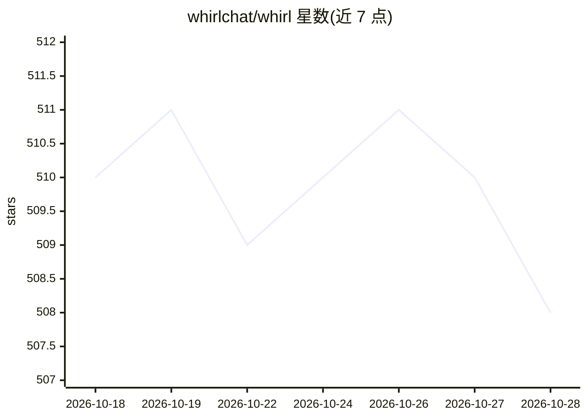

# whirlchat/whirl

⭐ 508 · TypeScript · MIT · 推送 2026-10-14 · [GitHub](https://github.com/whirlchat/whirl) · [官网](https://whirl.chat) · 组织维护

**可自托管的全栈 AI 聊天应用：多模型、长期记忆、活文档**

基于 Next.js 16 与 Convex 构建的全栈 AI 聊天应用，是 whirl.chat 站点的完整开源代码（MIT）。通过 OpenRouter 接入多家模型，支持在同一对话中混用并调节思考等级；提供可编辑与链接分享的活文档（文档/图表/交互页面）、跨对话的长期记忆、实时联网搜索与页面阅读、MCP 工具集成（含 OAuth）与可安装技能。锁定对话在设备端加密、仅由零保留模型应答。需 Bun、Convex 账号、Clerk 应用与 OpenRouter API key，从源码克隆运行。

## 筛选速览

| 维度 | 判定 | 备注 |
|---|---|---|
| AI 角色 | `ai-native` | 本体是模型或模型工具 |
| 许可风险 | `permissive` | MIT |
| 部署形态 | `None` |  |
| 模型依赖 | locked-api |  |
| 硬件要求 | — | 无带数字的原话,不猜 |
| 安装摩擦 | `low` | 无编译、无系统依赖或容器化 |
| 成熟度 | — | 结构信号不足 |

## 能力要点

- 经 OpenRouter 在同一对话中使用多家模型，可调思考等级
- 活文档：可编辑、可链接分享的文档/图表/交互页面
- MCP 工具集成（含 OAuth）与可安装技能
- 设备端加密的锁定聊天与隐身模式

## 适用场景

- 自托管一个支持多模型的 AI 聊天应用
- 在聊天中生成并继续编辑可分享的文档和页面
- 通过 MCP 接入自己的工具并安装扩展技能

## 场景标签

`聊天机器人` `AI 写作` · 领域:对话与助手

## 证据(README 行号)

> L13: Whirl is a full-stack AI chat app built on Next.js and Convex. It's the code
> L19: - **Every top model** in one conversation, routed through

## 星数曲线

2026-10-18 510 → 2026-10-28 508（-2）

---
*卡片 v1 · prompt 1.4 · 生成 2026-10-21 · 置信度 high · 依据 README sha `dd2b82a1ce92` · [字段定义](../../DATASET.md)*
