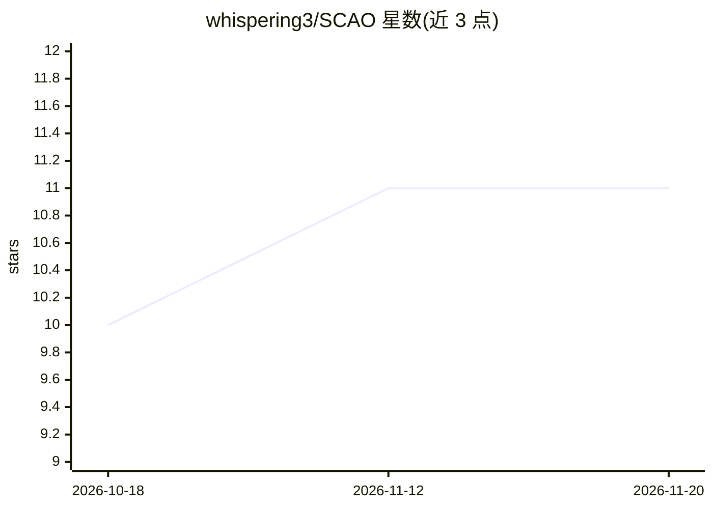

# whispering3/SCAO

⭐ 11 · Python · NOASSERTION · 推送 2026-11-13 · [GitHub](https://github.com/whispering3/SCAO) · 个人维护

**面向 PyTorch 训练的稀疏二阶优化器，可替换 AdamW**

SCAO 是用于稠密张量的 PyTorch 优化器，结合 Adam 式动量与分块 Kronecker 分解的曲率预条件器，定位为 AdamW 的即插即用替代。通过 pip 安装，提供 Hugging Face Trainer 与 Axolotl 集成、LoRA/QLoRA 预设（scao_3b 等 7 档规模预设）、可选 CUDA 扩展加速 int8 EMA 更新，并附 Qwen2.5-3B QLoRA 基准脚本与双种子可复现报告。README 明确声明不构成对 AdamW 的普遍改进，结果依赖模型、数据与训练条件；CUDA 扩展需在目标 GPU 环境单独构建，缺失时回退 PyTorch 实现。

## 筛选速览

| 维度 | 判定 | 备注 |
|---|---|---|
| AI 角色 | `ai-native` | 本体是模型或模型工具 |
| 许可风险 | `none` | NOASSERTION |
| 部署形态 | `library` | 以包/库形式分发 |
| 模型依赖 | — | README 未给出锁定关系 |
| 硬件要求 | — | 无带数字的原话,不猜 |
| 安装摩擦 | `medium` | 含编译或系统依赖之一 |
| 成熟度 | — | 结构信号不足 |

## 能力要点

- Adam 动量 + 分块 Kronecker 因子分解曲率预条件器
- Hugging Face Trainer 与 Axolotl 集成，7 档规模预设（scao_sub1b 至 scao_125b）
- 可选 CUDA 扩展加速 int8 EMA 更新，缺失时自动回退 PyTorch 实现
- 内置基准脚本输出含版本、数据指纹与 SHA-256 代码指纹的 JSON 记录

## 适用场景

- 为 LLM 的 LoRA/QLoRA 微调替换 AdamW 优化器
- 在切换生产训练配置前做多种子匹配实验
- 评估优化器状态内存与吞吐的权衡（int8/FP32 EMA、块大小消融）

## 场景标签

`微调` · 领域:训练与推理

## 证据(README 行号)

> L8: Sparse Curvature-Aware Optimizer (SCAO) is a PyTorch optimizer for dense
> L9: tensors. It combines Adam-style moments with a blockwise,
> L166: The package intentionally does not compile CUDA code during `pip install`,

## 星数曲线

2026-10-18 10 → 2026-11-20 11（+1）

---
*卡片 v1 · prompt 1.4 · 生成 2026-11-18 · 置信度 high · 依据 README sha `914e3f3655a1` · [字段定义](../../DATASET.md)*
