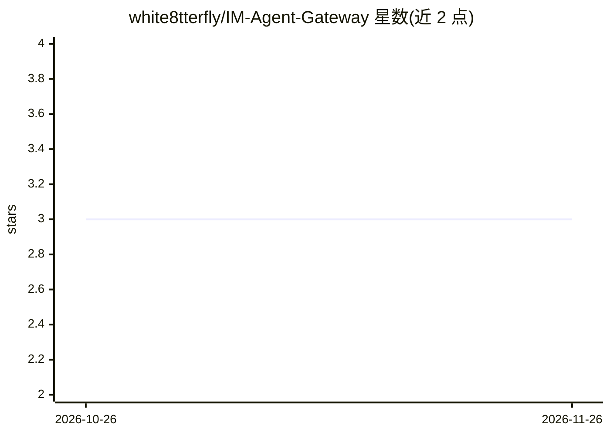

# white8tterfly/IM-Agent-Gateway

⭐ 3 · Python · MIT · 推送 2026-11-11 · [GitHub](https://github.com/white8tterfly/IM-Agent-Gateway) · 个人维护 · 中文 README

**把企业微信、飞书等 IM 接入多个 AI Agent 的网关平台**

面向需要让 IM 用户使用 AI Agent 的开发者与企业：内置企业微信、飞书、Web 控制台三种通道与五种 Agent，通过 IMChannel/BaseAgent 两套接入契约实现扩展。核心机制包括消息归一化为 InboundMessage、按用途与复杂度的两级智能路由（决策模型不可用时退化为关键词计分）、统一流式回传、会话级任务队列，以及可选的消息唤醒（待命进程）与 Web 管理台。以 Python 编写，提供 CLI 管理命令与契约测试脚本。

## 筛选速览

| 维度 | 判定 | 备注 |
|---|---|---|
| AI 角色 | `ai-ecosystem` | LLM/agent 周边工具 |
| 许可风险 | `permissive` | MIT |
| 部署形态 | `desktop` | 安装包/桌面程序 |
| 模型依赖 | locked-api |  |
| 硬件要求 | — | 无带数字的原话,不猜 |
| 安装摩擦 | `low` | 无编译、无系统依赖或容器化 |
| 成熟度 | — | 结构信号不足 |

## 能力要点

- 实现 IMChannel/BaseAgent 契约即可接入新通道与新 Agent，平台层不硬编码
- 两级路由：先判用途（对话/编码/办公），再按复杂度选择，可降级为关键词计分
- 统一流式回传与会话记忆，同一会话内任务串行排队
- 可选消息唤醒：待命进程监听，收到消息再启动完整服务

## 适用场景

- 让团队成员在企业微信、飞书里直接调用编码或对话 Agent
- 统一管理多个 Agent 的开关、路由与默认模型
- 轻量设备上用消息唤醒避免服务常驻占用资源

## 场景标签

`聊天机器人` `Agent 框架` · 领域:Agent 开发

## 证据(README 行号)

> L11: 把企业微信、飞书、Web 控制台等 IM 通道接入多个 AI Agent，统一完成消息归一化、智能路由与流式回传。
> L13: 平台的核心是一条接入契约：新增 IM 只实现 `IMChannel`，新增 Agent 只实现 `BaseAgent`，在 `.env` 中声明即可加载。网关、路由与管理层不硬编码任何具体通道或 Agent。仓库内置的三种通道与五

## 星数曲线

2026-10-26 3 → 2026-11-26 3（+0）

---
*卡片 v1 · prompt 1.4 · 生成 2026-11-21 · 置信度 high · 依据 README sha `2fb2bfb376c2` · [字段定义](../../DATASET.md)*
