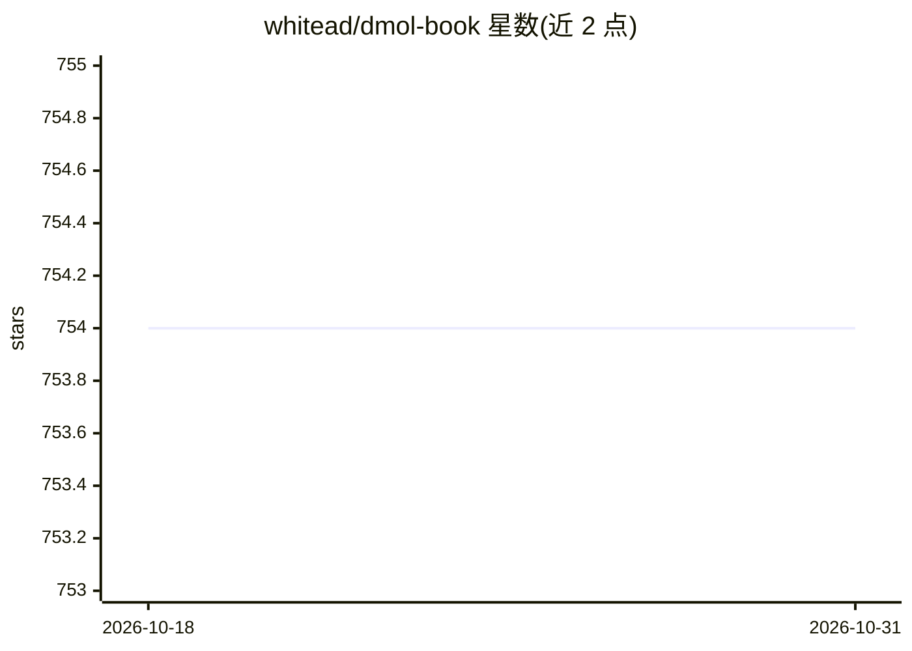

# whitead/dmol-book

⭐ 754 · Jupyter Notebook · NOASSERTION · 推送 2026-10-26 · [GitHub](https://github.com/whitead/dmol-book) · [官网](https://dmol.pub) · 个人维护

**分子与材料深度学习开放教科书，可在线阅读或本地构建**

Andrew White 编写的 Deep Learning for Molecules and Materials 在线书籍（dmol.pub），覆盖深度学习在化学分子与材料信息学领域的内容，主题标签为 chemistry、deep-learning、materials-informatics。仓库托管书稿源码，可在线阅读；本地构建需先安装 Jupyter Book，再用 jupyter-book build 命令生成 HTML 到 _build/html 目录。开发贡献使用 pre-commit 与 dev-requirements.txt。

## 筛选速览

| 维度 | 判定 | 备注 |
|---|---|---|
| AI 角色 | `ai-knowledge` | 知识聚合/清单类 |
| 许可风险 | `none` | NOASSERTION |
| 部署形态 | `library` | 以包/库形式分发 |
| 模型依赖 | — | README 未给出锁定关系 |
| 硬件要求 | — | 无带数字的原话,不猜 |
| 安装摩擦 | `low` | 无编译、无系统依赖或容器化 |
| 成熟度 | — | 结构信号不足 |

## 能力要点

- 在线阅读于 dmol.pub
- 基于 Jupyter Book 构建，可本地生成 HTML
- 面向分子与材料的深度学习主题内容

## 适用场景

- 系统学习深度学习在化学与材料领域的应用
- 本地构建或克隆书稿进行阅读与批注
- 以贡献者身份参与书稿修订

## 场景标签

`教程课程` · 领域:学习与行业

## 证据(README 行号)

> L1: # Deep Learning for Molecules and Materials Book
> L5: View book at dmol.pub

## 星数曲线

2026-10-18 754 → 2026-10-31 754（+0）

---
*卡片 v1 · prompt 1.4 · 生成 2026-10-21 · 置信度 mid · 依据 README sha `ea6c9629368b` · [字段定义](../../DATASET.md)*
