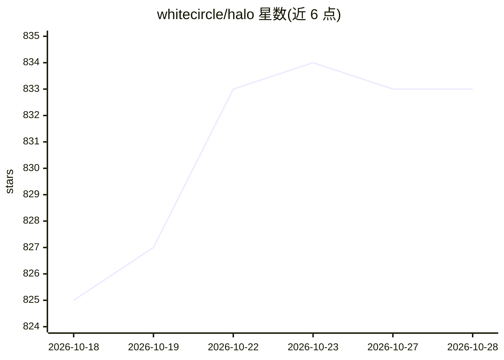

# whitecircle/halo

⭐ 834 · Python · NOASSERTION · 推送 2026-10-27 · [GitHub](https://github.com/whitecircle/halo) · [官网](https://whitecircle.com/halo) · 组织维护

**训练 LLM 与多模态模型的开源框架**

White Circle 开发的训练框架，覆盖预训练、SFT、偏好优化与全异步多轮 RL；同一套代码支持单 GPU 到多节点，提供 EP/CP/TP/ETP 并行、FSDP2、BF16 训练与分布式 rollout。直接训练 Hugging Face 模型，检查点保持 from_pretrained 兼容；RL rollout 通过 Ray actor 对接 vLLM/SGLang 服务器并以 NCCL 推送权重。以 Blackwell/Hopper 两套 Docker 镜像分发，无需宿主 Python 环境；集成 DeepEP、FlashAttention 4、Liger 等优化。

## 筛选速览

| 维度 | 判定 | 备注 |
|---|---|---|
| AI 角色 | `ai-ecosystem` | LLM/agent 周边工具 |
| 许可风险 | `none` | NOASSERTION |
| 部署形态 | `self-host` | docker 或自建部署 |
| 模型依赖 | local-ok | 支持本地模型 |
| 硬件要求 | — | 无带数字的原话,不猜 |
| 安装摩擦 | `low` | 无编译、无系统依赖或容器化 |
| 成熟度 | — | 结构信号不足 |

## 能力要点

- 支持预训练/SFT/偏好优化/多轮异步 RL 的统一并行与检查点栈
- EP/CP/TP/ETP 并行直接加在 Hugging Face 模型上，检查点保持 from_pretrained 兼容
- 异步 RL 通过 Ray + vLLM/SGLang rollout 服务器，权重经 NCCL 推送
- QLoRA 示例可在 24GB 消费级 GPU 上运行（Qwen3-4B 峰值 7.9 GiB）

## 适用场景

- 在多 GPU/多节点集群上做 LLM 或 VLM 的预训练与后训练
- 对 MoE 模型做 EP/CP 组合并行训练
- 用 vLLM 或 SGLang rollout 服务器跑异步 GRPO 等多轮 RL
- 在单张消费级 GPU 上做 QLoRA 微调

## 场景标签

`模型训练` `微调` `强化学习` · 领域:训练与推理

## 证据(README 行号)

> L12: Halo is an open-source framework built by White Circle for training large language and multimodal models. It suppor
> L35: - **RL is asynchronous, with a clean Transformers ↔ vLLM/SGLang split.** Multi-turn environment rollouts run as Ray

## 星数曲线

2026-10-18 825 → 2026-10-28 833（+8）

---
*卡片 v1 · prompt 1.4 · 生成 2026-10-21 · 置信度 high · 依据 README sha `14508e1911cc` · [字段定义](../../DATASET.md)*
