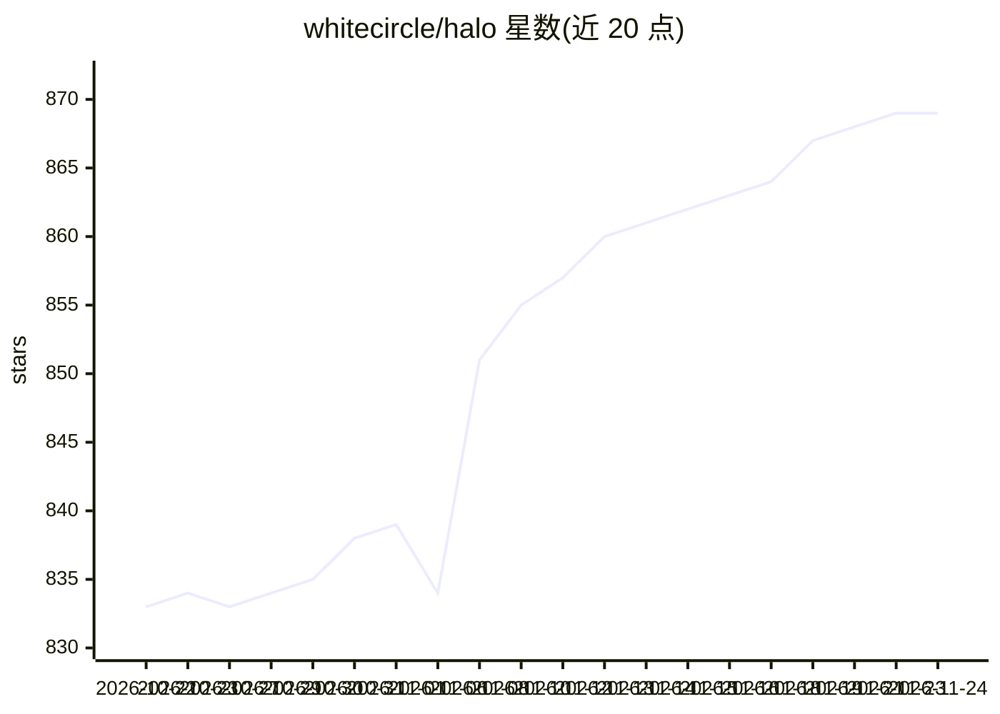

# whitecircle/halo

⭐ 869 · Python · NOASSERTION · 推送 2026-11-23 · [GitHub](https://github.com/whitecircle/halo) · [官网](https://whitecircle.com/halo) · 组织维护

**大模型与多模态模型训练框架：预训练/SFT/RL 一体**

White Circle 开发的开源训练框架，覆盖预训练、SFT、偏好优化与全异步多轮 RL。同一代码库可在单 GPU 或多节点运行，支持 EP/CP/TP/ETP/PP/FSDP2 等并行方式。直接训练 Hugging Face 模型，checkpoint 保持标准 SafeTensors 格式。RL 侧通过 Ray actor 对接 vLLM 或 SGLang 推理服务器进行异步多轮 rollout。提供 Blackwell 与 Hopper 两类 Docker 镜像，无需宿主 Python 环境，内置面向编码 agent 的技能与文档。

## 筛选速览

| 维度 | 判定 | 备注 |
|---|---|---|
| AI 角色 | `ai-ecosystem` | LLM/agent 周边工具 |
| 许可风险 | `none` | NOASSERTION |
| 部署形态 | `self-host` | docker 或自建部署 |
| 模型依赖 | local-ok | 支持本地模型 |
| 硬件要求 | — | 无带数字的原话,不猜 |
| 安装摩擦 | `low` | 无编译、无系统依赖或容器化 |
| 成熟度 | — | 结构信号不足 |

## 能力要点

- 支持预训练、SFT、偏好优化、蒸馏与全异步多轮 RL
- EP/CP/TP/ETP/PP 多轴并行，可单独或组合配置
- 直接训练 Hugging Face 模型，checkpoint 兼容 from_pretrained
- 训练镜像内置 Claude Code/Codex 可发现的 agent 技能

## 适用场景

- 在多节点集群上微调大型 MoE 模型
- 运行带环境交互的异步 GRPO 强化学习训练
- 单 GPU 上做 LoRA 微调
- 用编码 agent 辅助配置和调试分布式训练任务

## 场景标签

`模型训练` `微调` `强化学习` `多模态` · 领域:感知与多模态

## 证据(README 行号)

> L13: Halo is an open-source framework built by White Circle for training large language and multimodal models. It suppor
> L40: - **RL is asynchronous, with a clean Transformers ↔ vLLM/SGLang split.** Multi-turn environment rollouts run as Ray
> L76: Halo ships as separate Docker images for Blackwell and Hopper, with PyTorch, Flash Attention, and

## 星数曲线

2026-10-22 833 → 2026-11-24 869（+36）

---
*卡片 v1 · prompt 1.4 · 生成 2026-11-24 · 置信度 high · 依据 README sha `2677dda374d7` · [字段定义](../../DATASET.md)*
