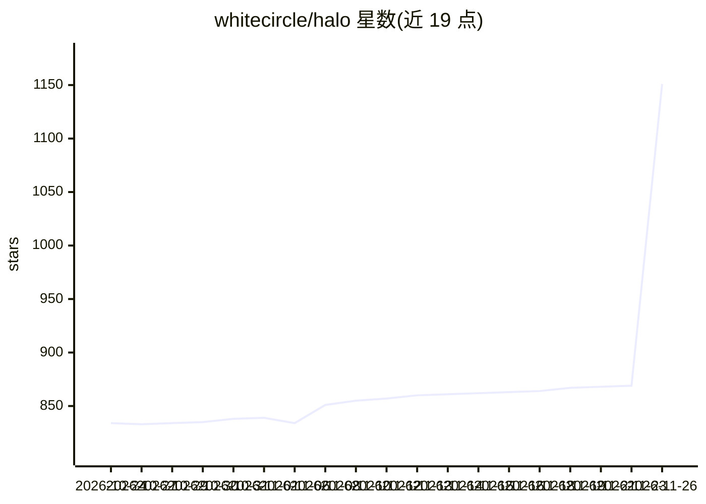

# whitecircle/halo

⭐ 1,151 · Python · NOASSERTION · 推送 2026-11-25 · [GitHub](https://github.com/whitecircle/halo) · [官网](https://whitecircle.com/halo) · 组织维护

**面向研究者的大语言与多模态模型训练框架**

White Circle 开发的开源训练框架，覆盖预训练、SFT、偏好优化与全异步多轮 RL（GRPO）。同一代码库可在单 GPU 或多节点运行，内置 EP/CP/TP/ETP/PP/FSDP2 并行与 BF16 训练；直接训练 Hugging Face 模型，checkpoint 保持 SafeTensors 格式并通过 from_pretrained 加载。RL 侧以 Ray actor 对接 vLLM/SGLang 推理服务器，通过 NCCL 同步权重。以 Docker 镜像分发（Blackwell/Hopper 两个架构版本），无需宿主 Python 环境。

## 筛选速览

| 维度 | 判定 | 备注 |
|---|---|---|
| AI 角色 | `ai-ecosystem` | LLM/agent 周边工具 |
| 许可风险 | `none` | NOASSERTION |
| 部署形态 | `self-host` | docker 或自建部署 |
| 模型依赖 | local-ok | 支持本地模型 |
| 硬件要求 | — | 无带数字的原话,不猜 |
| 安装摩擦 | `low` | 无编译、无系统依赖或容器化 |
| 成熟度 | — | 结构信号不足 |

## 能力要点

- 支持预训练、SFT、偏好优化与全异步多轮 RL（GRPO）
- EP/CP/TP/ETP/PP/FSDP2 多轴并行，单 GPU 到多节点同一代码库
- 直接训练 Hugging Face 模型，checkpoint 为标准 SafeTensors
- RL rollout 以 Ray actor 对接 vLLM/SGLang，权重经 NCCL 同步

## 适用场景

- 对 LLM/VLM 做预训练、SFT 或 LoRA 微调
- 跑多轮、可验证奖励的异步 GRPO 强化学习
- 在多节点集群上做 MoE 模型的分布式训练
- 导出/合并 EP 分片 checkpoint 或做低精度量化

## 场景标签

`微调` `模型训练` `强化学习` · 领域:训练与推理

## 证据(README 行号)

> L13: Halo is an open-source framework built by White Circle for training large language and multimodal models. It suppor
> L40: - **RL is asynchronous, with a clean Transformers ↔ vLLM/SGLang split.** Multi-turn environment rollouts run as Ray
> L76: Halo ships as separate Docker images for Blackwell and Hopper, with PyTorch, Flash Attention, and

## 星数曲线

2026-10-24 834 → 2026-11-26 1,151（+317）

---
*卡片 v1 · prompt 1.4 · 生成 2026-11-25 · 置信度 high · 依据 README sha `2b7bc6920530` · [字段定义](../../DATASET.md)*
