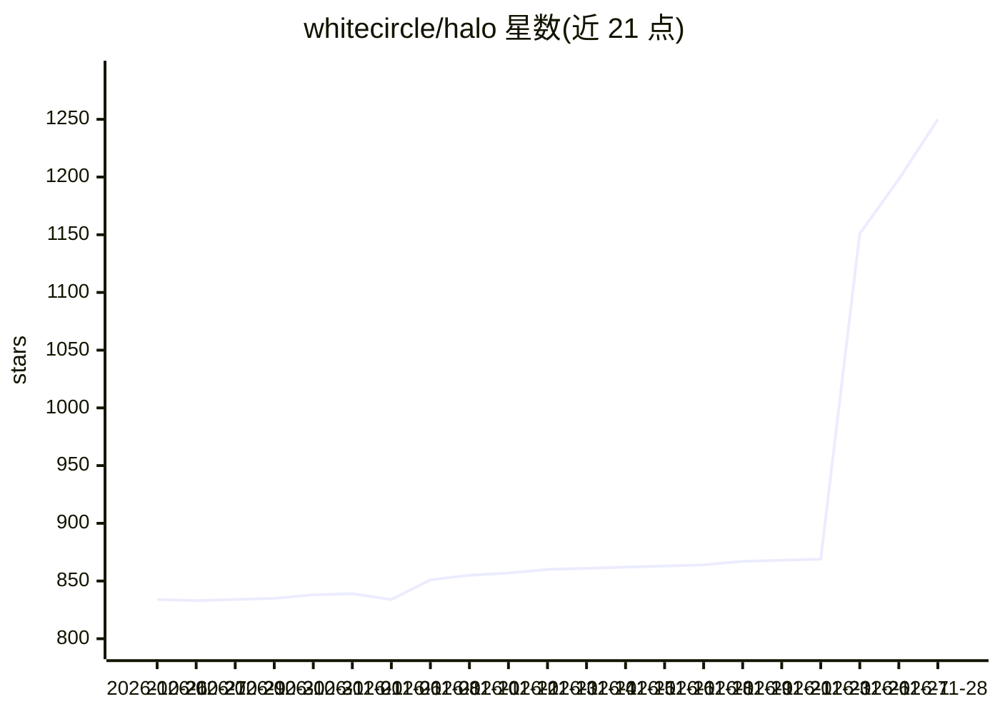

# whitecircle/halo

⭐ 1,250 · Python · NOASSERTION · 推送 2026-11-27 · [GitHub](https://github.com/whitecircle/halo) · [官网](https://whitecircle.com/halo) · 组织维护

**训练大语言与多模态模型的开源框架：覆盖预训练、SFT 到异步 RL**

White Circle 开发的开源训练框架，支持预训练、SFT、偏好优化、蒸馏与全异步多轮 RL。核心机制：直接加载 Hugging Face 模型并就地添加并行层（EP/CP/TP/ETP/PP），基于 PyTorch FSDP2/DTensor/DeviceMesh 与 DeepEP 构建，检查点保持标准 SafeTensors 格式。训练与 rollout 服务分进程运行，rollout 通过 Ray actor 对接 vLLM/SGLang 服务器，权重经 NCCL 同步。以 Docker 镜像分发（Blackwell/Hopper 两版），命令行工具为 halo launch，另附面向 Claude Code/Codex 的 agent skills 与双版本文档（human-docs 与 agent-docs）。

## 筛选速览

| 维度 | 判定 | 备注 |
|---|---|---|
| AI 角色 | `ai-ecosystem` | LLM/agent 周边工具 |
| 许可风险 | `none` | NOASSERTION |
| 部署形态 | `self-host` | docker 或自建部署 |
| 模型依赖 | local-ok | 支持本地模型 |
| 硬件要求 | — | 无带数字的原话,不猜 |
| 安装摩擦 | `low` | 无编译、无系统依赖或容器化 |
| 成熟度 | — | 结构信号不足 |

## 能力要点

- 支持预训练、SFT、偏好优化、蒸馏与异步多 turn RL（GRPO）
- EP/CP/TP/ETP/PP 并行可组合配置，基于 FSDP2/DTensor/DeepEP
- 直接训练 Hugging Face 模型，检查点保持 SafeTensors 与 from_pretrained 兼容
- 镜像内置面向 Claude Code 与 Codex 的仓库 agent skills，文档分 human-docs 与 agent-docs

## 适用场景

- 对大语言或多模态模型做 LoRA 或全参微调
- 运行带环境交互的多轮异步 GRPO 强化学习训练
- 单 GPU 到多节点扩展训练并使用专家/张量/流水线并行
- 用 coding agent 辅助配置并行参数与调试分布式训练

## 场景标签

`微调` `模型训练` `强化学习` · 领域:训练与推理

## 证据(README 行号)

> L15: Halo is an open-source framework built by White Circle for training large language and multimodal models. It suppor
> L17: The same codebase runs on one GPU or across multiple nodes, with expert, context, tensor, expert-tensor and pipelin
> L48: - RL is asynchronous, with training and rollout serving in separate processes. Multi-turn environment rollouts run 

## 星数曲线

2026-10-26 834 → 2026-11-28 1,250（+416）

---
*卡片 v1 · prompt 1.4 · 生成 2026-11-27 · 置信度 high · 依据 README sha `ed0c32fefb13` · [字段定义](../../DATASET.md)*
