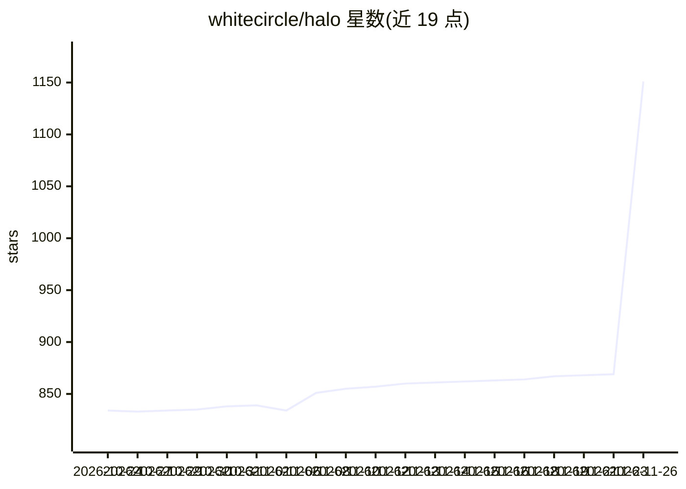

# whitecircle/halo

⭐ 1,151 · Python · NOASSERTION · 推送 2026-11-25 · [GitHub](https://github.com/whitecircle/halo) · [官网](https://whitecircle.com/halo) · 组织维护

**训练大模型与多模态模型的开源分布式框架**

White Circle 开发的开源训练框架，覆盖预训练、SFT、偏好优化与全异步多轮 RL（GRPO）。同一套代码可从单 GPU 扩展到多节点，提供 EP/CP/TP/ETT/PP 并行、FSDP2、BF16 训练与分布式 rollout。直接加载 Hugging Face 模型训练，checkpoint 保持标准 SafeTensors 格式；训练侧保持纯 Transformers，RL rollout 通过 vLLM 或 SGLang 服务进行。以 Docker 镜像分发，按 Blackwell/Hopper 架构区分，也支持本地 make 构建。

## 筛选速览

| 维度 | 判定 | 备注 |
|---|---|---|
| AI 角色 | `ai-ecosystem` | LLM/agent 周边工具 |
| 许可风险 | `none` | NOASSERTION |
| 部署形态 | `self-host` | docker 或自建部署 |
| 模型依赖 | local-ok | 支持本地模型 |
| 硬件要求 | — | 无带数字的原话,不猜 |
| 安装摩擦 | `low` | 无编译、无系统依赖或容器化 |
| 成熟度 | — | 结构信号不足 |

## 能力要点

- 支持预训练、SFT、偏好优化、蒸馏与异步多轮 RL 共用同一并行与 checkpoint 基础设施
- 直接训练 Hugging Face 模型，EP 层包装不产生第二份分布式模型代码
- RL rollout 以 Ray actor 运行于 vLLM/SGLang 服务，权重经 NCCL 推送
- 针对 MoE、LoRA 适配器与低精度（MXFP4/NVFP4）训练提供内核支持

## 适用场景

- 在单机或多节点上微调大语言模型与多模态模型
- 运行带环境交互的多轮异步 GRPO 强化学习训练
- 对 MoE 模型做专家并行（EP）训练与 LoRA 适配器训练

## 场景标签

`模型训练` `微调` `强化学习` `多模态` · 领域:感知与多模态

## 证据(README 行号)

> L13: Halo is an open-source framework built by White Circle for training large language and multimodal models. It suppor
> L40: - RL is asynchronous, with training and rollout serving in separate processes. Multi-turn environment rollouts run 
> L139: Halo ships as separate Docker images for Blackwell and Hopper, with PyTorch, Flash Attention, and

## 星数曲线

2026-10-24 834 → 2026-11-26 1,151（+317）

---
*卡片 v1 · prompt 1.4 · 生成 2026-11-26 · 置信度 high · 依据 README sha `9237b46fa668` · [字段定义](../../DATASET.md)*
