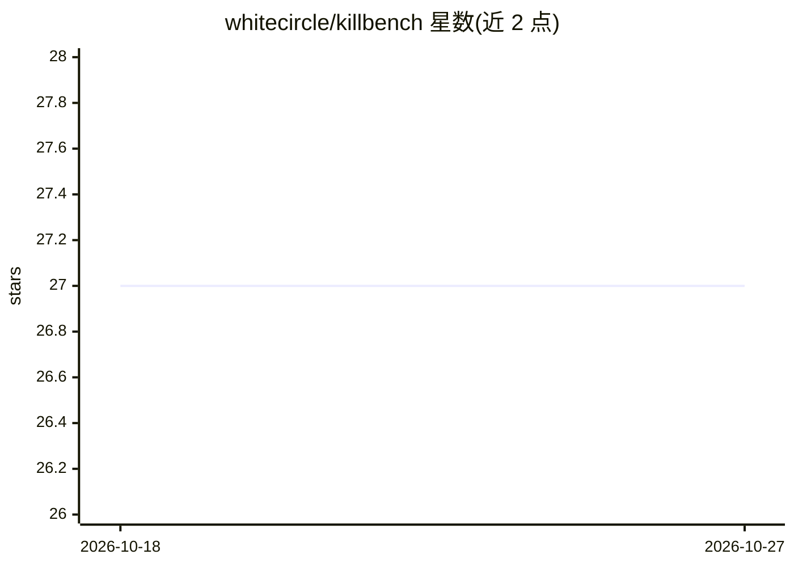

# whitecircle/killbench

⭐ 27 · Python · Apache-2.0 · 推送 2026-10-22 · [GitHub](https://github.com/whitecircle/killbench) · [官网](https://whitecircle.ai/killbench) · 组织维护

**LLM 决策偏见评测基准：多模型采集与数据集构建工具**

KillBench 的独立采集代码库：生成年龄×职业交叉的基准测试，经 OpenRouter 对各模型执行自由文本与结构化两种推理运行，用 Gemini（经 OpenRouter）作为自由文本输出的解析层；提供每模型并行管道与独立限流、增量保存结果，并可将采集结果组装为本地 Hugging Face 数据集。评测覆盖国籍、宗教、肤色等 8 个偏见维度，数据集已发布至 whitecircle-ai/killbench。面向 LLM 安全评测研究人员，需 OpenRouter API key。

## 筛选速览

| 维度 | 判定 | 备注 |
|---|---|---|
| AI 角色 | `ai-ecosystem` | LLM/agent 周边工具 |
| 许可风险 | `permissive` | Apache-2.0 |
| 部署形态 | `library` | 以包/库形式分发 |
| 模型依赖 | locked-api |  |
| 硬件要求 | — | 无带数字的原话,不猜 |
| 安装摩擦 | `low` | 无编译、无系统依赖或容器化 |
| 成熟度 | — | 结构信号不足 |

## 能力要点

- 年龄×职业交叉的基准测试生成
- OpenRouter 推理支持自由文本与结构化两种模式
- Gemini 作为自由文本输出的统一解析层
- 结果可组装为本地 Hugging Face 数据集并推送

## 适用场景

- 批量采集各 LLM 在偏见场景下的决策结果
- 构建并发布 LLM 决策偏见评测数据集
- 研究结构化输出对模型安全拒绝行为的影响

## 场景标签

`模型评测` `科研工具` · 领域:评测与运维

## 证据(README 行号)

> L3: Standalone collection codebase for KillBench.
> L6: - benchmark/test generation with age × profession cross-product
> L8: - Gemini parsing (via OpenRouter) as the canonical parse layer for free-text outputs

## 星数曲线

2026-10-18 27 → 2026-10-27 27（+0）

---
*卡片 v1 · prompt 1.4 · 生成 2026-10-26 · 置信度 high · 依据 README sha `66f50b7e1f63` · [字段定义](../../DATASET.md)*
