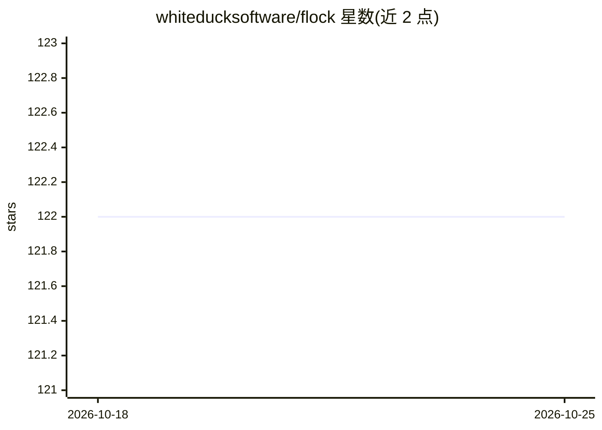

# whiteducksoftware/flock

⭐ 122 · Python · MIT · 推送 2026-10-15 · [GitHub](https://github.com/whiteducksoftware/flock) · [官网](https://whiteducksoftware.github.io/flock/) · 组织维护

**面向开发者的声明式黑板架构多智能体编排框架**

基于黑板模式编排 LLM 智能体的 Python 框架：每个智能体通过 Pydantic 类型声明消费与发布的制品，工作流由订阅关系涌现，无需绘制图或维护长提示词。支持 AND/OR 逻辑门、扇出发布、语义订阅（本地 ONNX 嵌入）、定时调度、租户/私有/标签三级可见性控制、SQLite 与 Dapr 持久化、熔断器等安全机制。内置实时仪表盘、OpenTelemetry 追踪与 REST API，决策模型以校准概率代替文本生成路由，并可将应用托管为 Microsoft Foundry 智能体。

## 筛选速览

| 维度 | 判定 | 备注 |
|---|---|---|
| AI 角色 | `ai-ecosystem` | LLM/agent 周边工具 |
| 许可风险 | `permissive` | MIT |
| 部署形态 | `library` | 以包/库形式分发 |
| 模型依赖 | locked-api |  |
| 硬件要求 | — | 无带数字的原话,不猜 |
| 安装摩擦 | `low` | 无编译、无系统依赖或容器化 |
| 成熟度 | — | 结构信号不足 |

## 能力要点

- Pydantic 契约驱动的黑板编排，智能体只声明订阅不互相感知
- 决策模型按校准概率路由（Choice/YesNo/Scale/Checklist），低于阈值进入 UNSURE 分支
- 可见性控制（租户/私有/标签）内置于黑板，非外挂
- 内置仪表盘、OpenTelemetry 追踪、REST API 与 SQLite/Dapr 持久化

## 适用场景

- 编排多个 LLM 智能体完成需要并行与汇合的工作流（如 bug 检测+安全审计→评审）
- 用工单语义路由或多选项决策模型做分类与合规检查
- 多租户场景下控制智能体间数据可见性并持久化黑板历史

## 场景标签

`多智能体` `Agent 框架` · 领域:Agent 开发

## 证据(README 行号)

> L15: Flock orchestrates AI agents on a **blackboard**. Each agent declares which typed artifacts it consumes and which i

## 星数曲线

2026-10-18 122 → 2026-10-25 122（+0）

---
*卡片 v1 · prompt 1.4 · 生成 2026-10-23 · 置信度 high · 依据 README sha `ddaa12bf49c2` · [字段定义](../../DATASET.md)*
