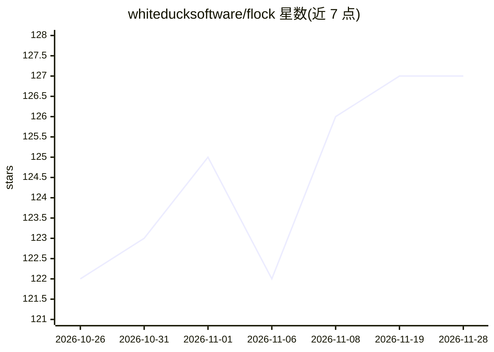

# whiteducksoftware/flock

⭐ 127 · Python · MIT · 推送 2026-11-03 · [GitHub](https://github.com/whiteducksoftware/flock) · [官网](https://whiteducksoftware.github.io/flock/) · 组织维护

**声明式黑板多智能体编排框架，用类型契约替代提示图**

Flock 是一个 Python 多智能体编排框架：各智能体声明消费与发布的 Pydantic 类型化 artifact，工作流由订阅关系在黑板上自然涌现，无需手工连线。独立智能体并行运行，内置决策模型路由（按概率而非生成文本）、语义订阅（本地嵌入）、可视化控制、实时仪表盘与 OpenTelemetry 追踪。默认引擎为 DSPy，支持 SQLite/Dapr 持久化、可见性访问控制、REST API 与浏览器发布 artifact。以 flock-core 包发布，微软 Foundry 托管适配器需安装额外 extra。

## 筛选速览

| 维度 | 判定 | 备注 |
|---|---|---|
| AI 角色 | `ai-ecosystem` | LLM/agent 周边工具 |
| 许可风险 | `permissive` | MIT |
| 部署形态 | `library` | 以包/库形式分发 |
| 模型依赖 | locked-api |  |
| 硬件要求 | — | 无带数字的原话,不猜 |
| 安装摩擦 | `low` | 无编译、无系统依赖或容器化 |
| 成熟度 | — | 结构信号不足 |

## 能力要点

- Pydantic 类型契约定义务，Pydantic 校验所有输出，无图无提示词
- 决策模型在一次前向中输出带校准概率的类型化答案（Choice/YesNo/Scale/Checklist）
- 基于 all-MiniLM-L6-v2 本地嵌入的语义订阅，无需外部 API
- 内置仪表盘、OpenTelemetry 追踪、熔断器与自触发防护

## 适用场景

- 用多个专家智能体并行处理工单分诊与告警聚合
- 按租户/标签控制 artifact 可见性的多租户场景
- 需要对 100+ 控项做合规检查清单决策
- 通过仪表盘实时观察并发布 artifact 调试智能体流程

## 场景标签

`多智能体` `Agent 框架` · 领域:Agent 开发

## 证据(README 行号)

> L15: Flock orchestrates AI agents on a **blackboard**. Each agent declares which typed artifacts it consumes and which i
> L211: - **Engines** decide how an agent turns inputs into outputs: DSPy (the default), decision models or your own logic
> L220: 📖 Agent components · Orchestrator components · DSPy engine and Azure · Local models

## 星数曲线

2026-10-26 122 → 2026-11-28 127（+5）

---
*卡片 v1 · prompt 1.4 · 生成 2026-11-28 · 置信度 high · 依据 README sha `7310449ceb14` · [字段定义](../../DATASET.md)*
