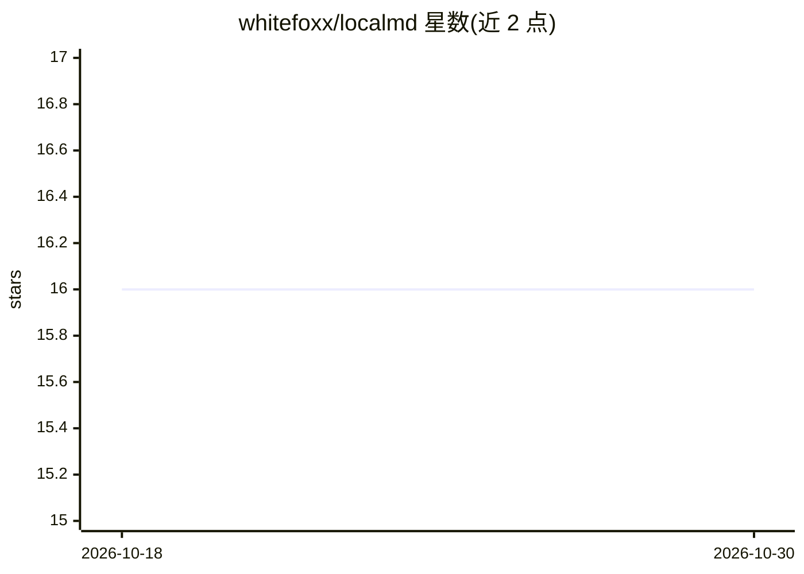

# whitefoxx/localmd

⭐ 16 · TypeScript · MIT · 推送 2026-09-21 · [GitHub](https://github.com/whitefoxx/localmd) · [官网](https://localmd.app) · 个人维护

**浏览器内本地优先的 AI 知识库：agent 在你的文件夹里读写并生成带引用的 wiki**

纯静态的 Vue 3 网页应用，通过 File System Access API 直接读写用户本地文件夹，无后端、不上传文件。用户自带模型 API key，agent 可列出/读取/搜索/编辑文件，将 PDF/EPUB 解析为块级索引，引用可点击跳回原文段落；变更需经 diff 审阅确认。内置 Markdown 编辑器、wikilinks、反向链接、全文搜索、isomorphic-git 版本历史与 GitHub 同步，可接入 MCP 服务器与配套浏览器扩展。限制：仅支持 Chromium 浏览器，生产环境需 https。

## 筛选速览

| 维度 | 判定 | 备注 |
|---|---|---|
| AI 角色 | `ai-native` | 本体是模型或模型工具 |
| 许可风险 | `permissive` | MIT |
| 部署形态 | `self-host` | docker 或自建部署 |
| 模型依赖 | locked-api |  |
| 硬件要求 | — | 无带数字的原话,不猜 |
| 安装摩擦 | `low` | 无编译、无系统依赖或容器化 |
| 成熟度 | — | 结构信号不足 |

## 能力要点

- 无后端纯静态页面，经 File System Access API 本地读写，文件不上传
- PDF/EPUB 块级索引，引用 token 点击跳回原段落并高亮
- agent 文件操作经 diff 审阅面板逐次确认
- isomorphic-git 浏览器内 git 历史，可选 GitHub REST 同步与 MCP 服务器接入

## 适用场景

- 在已有笔记文件夹上直接叠加 AI agent 与 wiki 链接，不迁移格式
- 向 agent 提问并沿可点击引用核验 PDF/EPUB 出处段落
- 本地优先地管理知识库版本历史并同步到 GitHub

## 场景标签

`知识库管理` `文档问答` · 领域:知识与检索

## 证据(README 行号)

> L16: There is no backend. The app is a static page: it reads and writes your files
> L17: through the File System Access API, and it talks to whichever model provider you
> L40: - **An agent that works in your files.** It lists, reads, searches, writes and
> L42:  it lands. Bring a key for Anthropic, OpenAI, DeepSeek, Gemini, xAI, Groq,

## 星数曲线

2026-10-18 16 → 2026-10-30 16（+0）

---
*卡片 v1 · prompt 1.4 · 生成 2026-10-30 · 置信度 mid · 依据 README sha `7f8bdb9a3d91` · [字段定义](../../DATASET.md)*
